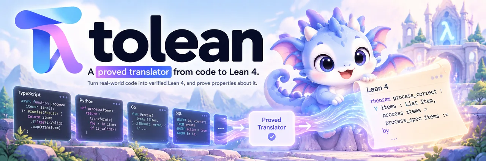

<p align="center">
  
</p>

<p align="center">
  <a href="https://github.com/shihangw/tolean/actions/workflows/ci.yml"></a>
  <a href="https://www.npmjs.com/package/tolean"></a>
  <a href="https://lean-lang.org"></a>
  <a href="https://shihangw.github.io/tolean/"></a>
  <a href="https://shihangw.github.io/tolean/docs/"></a>
</p>

# Tolean

Tolean translates source code into Lean 4, so that proofs about a program are
about its real source. It reads a subset of each language and writes Lean
definitions that a person can read. It refuses everything else, and it
reports the file, the line and the reason. In CI, Tolean generates the Lean
again and fails if the result differs from the committed copy. Then
`lake build` checks the proofs.

Tolean reads three languages:

- **TypeScript**: pure functions become plain Lean functions.
- **Go**: code with effects is supported too. A function that calls methods on
  an interface, such as a database store, becomes a function in a state
  monad, so a proof can plug in a model of what the interface does.
- **PostgreSQL** queries written for sqlc, with the schema their migrations
  build: each query becomes a function from a database to a result and a new
  database. A model of READ COMMITTED isolation describes what concurrent
  transactions can do between statements.

A proof can join the last two: the Go code's theorem holds for any store that
keeps a stated contract, and a second theorem shows that the store built on
the translated queries keeps it.

To try Tolean without installing it, open the
[playground](https://shihangw.github.io/tolean/). There you edit an example,
and Lean checks its proofs in the browser. The
[docs site](https://shihangw.github.io/tolean/docs/) has this README and
every page in `docs/`, with an index and full-text search.

## Getting started

A sort is a good first example, because everyone knows what it must do. This
Go function sorts a slice by insertion:

```go
package sorting

// Insert puts x into the sorted slice xs, before the first larger element.
func Insert(xs []int64, x int64) []int64 {
	out := []int64{}
	placed := false
	for _, y := range xs {
		if !placed && x <= y {
			out = append(out, x)
			placed = true
		}
		out = append(out, y)
	}
	if !placed {
		out = append(out, x)
	}
	return out
}

// Sort returns the elements of xs in ascending order.
func Sort(xs []int64) []int64 {
	out := []int64{}
	for _, x := range xs {
		out = Insert(out, x)
	}
	return out
}
```

Install Tolean from npm with `npm install --save-dev tolean`. The package
has the `tolean` command for macOS, Linux and Windows, and the Lean package
that the generated code imports. [The npm
package](docs/typescript/README.md#the-npm-package) describes what else it
has.

To translate it, list the source in a `tolean.json` file at the project root:

```json
{ "go": { "sources": ["sorting/*.go"] } }
```

Then run `tolean translate`. It writes `sorting/Sorting.lean`, where each
`range` loop becomes a recursive function over a list. In CI, run
`tolean translate --check`, which fails when the Lean is out of date.

We strongly recommend that you run Tolean through `tolean.json`. The
project file is the stable interface. The single-file commands, such as
`tolean translate-go`, are for Tolean's own tests, and their arguments can
change between versions.

Then you write the claim. Here it has two parts, and both are needed. The
output of `Sort` is sorted, and it is a permutation of the input. Without the
second part, a sort that returns an empty list would satisfy the claim. You
state each part as a `def … : Prop` in `Spec`, prove it in `Proof`, and
`lake build` checks the proofs.

## Why Tolean

Coding agents now write more code than people can review. A reviewer skims
the diff and approves it, and tests check only the inputs that someone
thought of. Neither shows that the code is correct for every input.

A proof does. A test shows that the right password logs a user in. A proof
shows that no wrong password ever logs a user in, for every possible input.
With Tolean, you review what the code must do, and the Lean kernel checks
that the code does it.

Tolean moves review from the code to the claim, and it keeps three things
out of the trusted path:

- **No model of the code written by hand or by an LLM.** The translator
  writes the Lean from the source that runs, and CI fails if the two differ.
  The translators are tested against reference implementations now; a proof
  that they are correct is the goal, and `tolean chain trust` lists what each
  claim still trusts.
- **No proof that you must read.** The kernel checks every step. An agent
  may write the proof, because a wrong proof does not pass.
- **No solver to trust.** A proof relies on a small kernel and the axioms it
  lists, not on the heuristics of an SMT solver (see
  [below](#why-a-proof-kernel-not-an-smt-solver)).

What remains is the claim, and a person must read it. A checker accepts a
true theorem that says nothing useful. For example, "the output is sorted"
holds for a sort that returns an empty list, because the claim never says
that the output has the same elements as the input. So write each claim as
one property of one component:

- a **precondition**, which is true when the code starts;
- a **postcondition**, which is true when it returns;
- an **invariant**, which stays true the whole time, such as "a session
  token is never accepted after the logout that revoked it".

Then read the claim before you read the code, and check it on a few inputs
that it must accept and a few that it must reject. A proof does not create
trust. It moves trust from the code to the claim, so if no person read the
claim, nothing was verified.

## What is proved and what is trusted

Each link between the source and a theorem is proved by the Lean kernel,
tested against a reference, or trusted without a test. The table gives the
status of each link today. A theorem holds for the code that runs only as far
as the links it relies on are right, and `tolean chain trust` lists those
links for each claim.

| Link | TypeScript | Go | PostgreSQL |
|---|---|---|---|
| Parser | **Proved**: the parser reads the printed source of its own tree as the same tree.<br>Tested: the trees equal `tsc`'s, on the corpus and on random programs. | Tested: the trees equal `go/parser`'s. | Tested: through the two translators' checks, because there is no reference parser yet. |
| Translator | **Proved** in full for a file with a [certificate](docs/typescript/README.md#certificates).<br>**Proved** up to the printer: for every program it accepts, when the evaluator of its [Tolean IR](docs/decisions/2026-10-30-tolean-ir.md) gives a value, the interpreter gives the same value.<br>Tested: the printer link, because the corpus output is fixed and compiled, and so is the output for random programs.<br>Trusted: the printer link, that the printed Lean computes what the evaluator gives. No theorem can state it for every program, because the printed Lean is text, and it means something only after Lean compiles it. | **Proved** up to the printer for [pure functions](docs/go/README.md#what-is-proved): when the evaluator of the IR gives a value, the Go interpreter in Lean gives the same value.<br>Tested: the rest, because the corpus output is fixed and compiled. | Tested: the results agree with PostgreSQL 18 on generated scenarios. |
| Value model (the spec that generated code imports) | Tested: the number laws hold on every maintained Node release line. | Trusted: `int64` wrapping and errors, which are not tested yet. | Tested: values, errors and three-valued logic agree with PostgreSQL 18. |
| Concurrency model | None: the subset is single-threaded. | None: no goroutines. | **Proved**: the READ COMMITTED model's theorems.<br>Tested: the model, against the server. |
| Claims about the generated code | **Proved**. | **Proved**. | **Proved**. |
| What runs | Trusted: the JavaScript engine. | Trusted: the Go compiler. | Trusted: the PostgreSQL server and its constraints. |
| Inputs | Trusted: the inputs meet each theorem's preconditions, and the callers are responsible for it. A function can check its own inputs instead, and [a plan](docs/plans/input-checks.md) lets `tolean.json` require that. | Trusted: the inputs meet each theorem's preconditions, and the callers are responsible for it. A function can check its own inputs instead, and [a plan](docs/plans/input-checks.md) lets `tolean.json` require that. | Trusted: the inputs meet each theorem's preconditions, and the callers are responsible for it. A function can check its own inputs instead, and [a plan](docs/plans/input-checks.md) lets `tolean.json` require that. |
| Glue code | None: the functions are pure, so they need no glue to a store or a database. | Trusted: the glue between an interface and a real store. | Trusted: the code that calls the queries. |

The playground runs the translator compiled to WebAssembly, so it also
trusts that build: Lean's runtime built for a 32-bit target that Lean does
not support officially, the patches in `wasm/build.sh`, and Emscripten. The
npm package does not: it runs the native binary, built for each platform with
Lean's own toolchain. CI tests the WebAssembly build against the native command:
every corpus file and 200 random programs must give the same Lean or the
same refusal. A project that runs `tolean translate --check` in CI checks
its Lean with the native command, and a certificate holds whichever build
wrote the Lean, because the kernel checks it.

A certificate changes what one TypeScript file trusts. The file no longer
trusts the translator. It trusts the parser and the interpreter that defines
what the subset means (`tolean/TypeScript/Spec/Eval.lean`) instead. The
kernel checks that the parser gives the certificate's program for the file.
`tests/typescript/interpreter.test.ts` tests the interpreter against Node on
random programs, and a certificate also proves the printer link for its file.
Tolean also proves that the parser reads its own printed source back as the
same tree (`parseChars_reads`). Each language page lists its steps in more
detail.

Every link above also relies on parts of Lean: the kernel, the axioms, the
elaborator that reads the claims, and the compiled `tolean` binary, among
others. [What Tolean trusts in Lean itself](docs/trusting-lean.md) lists each
part, what Tolean uses it for, and whether a certified file trusts it. CI also
checks the built library again with `leanchecker`, which sends every
declaration back to the kernel.

## The verification chain

What Tolean produces is a verification chain: a path from the source code
that runs to theorems about it, where every link is proved, tested against a
reference, or trusted. The graphs show the chain for
[TypeScript](docs/typescript/verification.svg), [Go](docs/go/verification.svg)
and [PostgreSQL](docs/postgresql/verification.svg).

The chain is also data. Each translation writes a manifest next to its Lean
file, and a project lists its claims in `tolean.chain.json`. Then
`tolean chain check` fails when the chain no longer holds, and
`tolean chain trust` lists what a claim relies on that no proof covers.
[The verification chain](docs/verification-chain.md) describes the manifests
and the commands.

## The project file

A project lists what to translate in `tolean.json`, at its root, as in
[Getting started](#getting-started). `tolean translate` builds every unit,
and `tolean translate --check`, which CI runs, fails when a generated file is
not current. Use `tolean.json` in your project and in CI, because the
single-file commands are not a stable interface. [The project
file](docs/project-file.md) lists every setting.

## Why a proof kernel, not an SMT solver

Tools such as Verus and Dafny send each verification goal to an SMT solver,
such as Z3. Tolean writes Lean, and Lean's kernel checks every proof. The
trusted base is smaller, a proof can be checked again by any copy of the
kernel, a proof does not break when a solver changes its heuristics, and Lean
can prove facts about the translator itself. The cost is effort: someone must
ask for each proof, where a solver often finds one alone. [This decision
record](docs/decisions/2026-10-25-lean-not-smt.md) gives the full comparison.

## Build and check

To work on Tolean itself, [Build and check](docs/build-and-check.md) lists
the commands and what CI runs, and [Repository
layout](docs/repository-layout.md) describes where each part of Tolean lives
and how to add a language.

## Languages

Each language has its own page with the details of its parser, its
translator, the subset it accepts and how its checks work.

| Language | Input | Output | Trusted model | Details |
|---|---|---|---|---|
| TypeScript | Pure functions | Plain Lean functions, generic over the number type | `tolean/TypeScript/Spec/` | [TypeScript](docs/typescript/README.md) |
| Go | One package, from named root functions | Functions in `StateM State`, with interface calls as steps | `tolean/Go/Spec/Basic.lean` | [Go](docs/go/README.md) |
| PostgreSQL | sqlc queries and their migrations | Functions from a database to a result and a new database | `tolean/Sql/Spec/`, with a READ COMMITTED model | [PostgreSQL](docs/postgresql/README.md) |

## Claims and proofs

The Lean package also provides `#audit_claims Spec Proof`, in
`tolean/Audit.lean`. This command keeps what is claimed apart from how it is
proved. A claim is a `def … : Prop` in the namespace `Spec`. The command fails
the build unless each claim has a theorem with the same name in `Proof`, and
the theorem's type must be exactly that claim. Because of this, reviewers only
need to read the `Spec` files and `tolean/TypeScript/Spec/`, which is the
trusted model of JavaScript.

## Prior work

Tolean takes its design from two projects. It uses their ideas, but not their
code.

- [Aeneas](https://github.com/AeneasVerif/aeneas), together with
  [Charon](https://github.com/AeneasVerif/charon), translates safe Rust into
  pure Lean. Rust's borrow checker rules out aliasing, so Aeneas can turn a
  mutation in place into a pure update of a value. TypeScript has no borrow
  checker, so Tolean gets the same property from its subset instead. Only
  locals that the function owns can change, and the function can read an
  owned array only in its return value. [Tolean and Aeneas](docs/vs_aeneas.md)
  compares the two in more detail.
- [Ariadne](https://github.com/nathsou/ariadne) translates a TypeScript subset
  into readable Lean definitions, and it rejects what it cannot model. Ariadne
  also proves, once for all programs, that its definitions match a JavaScript
  interpreter, and it emits a `source` theorem for each function. Tolean
  proves the same match one file at a time, with a
  [certificate](docs/typescript/README.md#certificates). For each certified
  function, the kernel checks that the translated Lean equals what a
  JavaScript interpreter in Lean returns, for every input. Certificates cover
  the whole subset, loops and `number` values included. Tolean now also proves
  the translator once, for all programs, up to the printer that writes its
  intermediate representation, the Tolean IR, as text. A file without a
  certificate trusts that printer link: the printed Lean computes what the
  evaluator of the IR gives.

## License

Apache License 2.0. See [LICENSE](LICENSE).

## Meet Tulie

Tulie is Tolean's idol, a small dragon that everyone on the project adores.
Tulie carries your code into Lean 4 and proudly holds up the theorem that
comes out.

Tulie cheers for every proof that checks. A failed proof doesn't upset
Tulie, because the kernel caught the mistake, and that is the whole point.
When the build is green, Tulie naps. When a new theorem lands, Tulie hugs the
λ egg a little tighter.

If Tolean helps you prove something you care about, give the repository a
star. Tulie loves shiny things, and every star is one more fan.

<p align="center">
  
</p>
