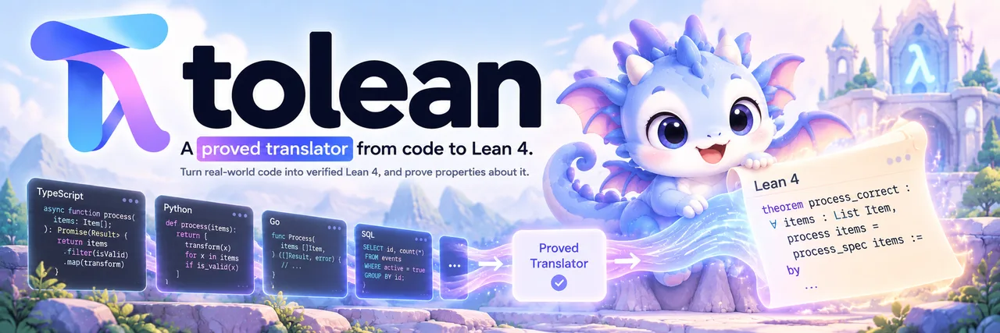

<p align="center">
  
</p>

# Tolean

Tolean translates source code into Lean 4, so that proofs about a program are
about its real source. It reads a subset of each language and writes Lean
definitions that a person can read. It refuses everything else, and it
reports the file, the line and the reason. In CI, Tolean generates the Lean
again and fails if the result differs from the committed copy. Then
`lake build` checks the proofs.

Tolean reads three languages:

- **TypeScript**: pure functions become plain Lean functions.
- **Go**: code with effects is supported too. A function that calls methods on
  an interface, such as a database store, becomes a function in a state
  monad, so a proof can plug in a model of what the interface does.
- **PostgreSQL** queries written for sqlc, with the schema their migrations
  build: each query becomes a function from a database to a result and a new
  database. A model of READ COMMITTED isolation describes what concurrent
  transactions can do between statements.

A proof can join the last two: the Go code's theorem holds for any store that
keeps a stated contract, and a second theorem shows that the store built on
the translated queries keeps it.

To try Tolean without installing it, open the
[playground](https://shihangw.github.io/tolean/). There you edit an example,
and Lean checks its proofs in the browser.

## Getting started

A sort is a good first example, because everyone knows what it must do. This
Go function sorts a slice by insertion:

```go
package sorting

// Insert puts x into the sorted slice xs, before the first larger element.
func Insert(xs []int64, x int64) []int64 {
	out := []int64{}
	placed := false
	for _, y := range xs {
		if !placed && x <= y {
			out = append(out, x)
			placed = true
		}
		out = append(out, y)
	}
	if !placed {
		out = append(out, x)
	}
	return out
}

// Sort returns the elements of xs in ascending order.
func Sort(xs []int64) []int64 {
	out := []int64{}
	for _, x := range xs {
		out = Insert(out, x)
	}
	return out
}
```

To translate it, list the source in a `tolean.json` file at the project root:

```json
{ "go": { "sources": ["sorting/*.go"] } }
```

Then run `tolean translate`. It writes `sorting/Sorting.lean`, where each
`range` loop becomes a recursive function over a list. In CI, run
`tolean translate --check`, which fails when the Lean is out of date.

We strongly recommend that you run Tolean through `tolean.json`. The
project file is the stable interface. The single-file commands, such as
`tolean translate-go`, are for Tolean's own tests, and their arguments can
change between versions.

Then you write the claim. Here it has two parts, and both are needed. The
output of `Sort` is sorted, and it is a permutation of the input. Without the
second part, a sort that returns an empty list would satisfy the claim. You
state each part as a `def … : Prop` in `Spec`, prove it in `Proof`, and
`lake build` checks the proofs.

## Why Tolean

Coding agents now write more code than people can review. A reviewer skims
the diff and approves it, and tests check only the inputs that someone
thought of. Neither shows that the code is correct for every input.

A proof does. A test shows that the right password logs a user in. A proof
shows that no wrong password ever logs a user in, for every possible input.
With Tolean, you review what the code must do, and the Lean kernel checks
that the code does it.

Tolean moves review from the code to the claim, and it keeps three things
out of the trusted path:

- **No model of the code written by hand or by an LLM.** The translator
  writes the Lean from the source that runs, and CI fails if the two differ.
  The translators are tested against reference implementations now; a proof
  that they are correct is the goal, and `tolean chain trust` lists what each
  claim still trusts.
- **No proof that you must read.** The kernel checks every step. An agent
  may write the proof, because a wrong proof does not pass.
- **No solver to trust.** A proof relies on a small kernel and the axioms it
  lists, not on the heuristics of an SMT solver (see
  [below](#why-a-proof-kernel-not-an-smt-solver)).

What remains is the claim, and a person must read it. A checker accepts a
true theorem that says nothing useful. For example, "the output is sorted"
holds for a sort that returns an empty list, because the claim never says
that the output has the same elements as the input. So write each claim as
one property of one component:

- a **precondition**, which is true when the code starts;
- a **postcondition**, which is true when it returns;
- an **invariant**, which stays true the whole time, such as "a session
  token is never accepted after the logout that revoked it".

Then read the claim before you read the code, and check it on a few inputs
that it must accept and a few that it must reject. A proof does not create
trust. It moves trust from the code to the claim, so if no person read the
claim, nothing was verified.

## The verification chain

What Tolean produces is a verification chain: a path from the source code
that runs to theorems about it, where every link is proved, tested against a
reference, or trusted. The graphs show the chain for each language, and which
links are which:

- [TypeScript](docs/typescript/verification.svg)
- [Go](docs/go/verification.svg)
- [PostgreSQL](docs/postgresql/verification.svg)

Each language also splits into nested subsets: what the parser reads, what
the translator accepts, and what is proved. [This chart](docs/subsets.svg)
lists them.

### Chain manifests

The chain is also data. Each translation writes `<output>.chain.json` next to
the Lean file. It records the Tolean version, the SHA-256 of each source file
and of the output, and the links the output relies on (parser, translator,
Spec, runtime), each with a status and the check that supports it.

A project adds `tolean.chain.json`. It lists the file manifests, its own links
(such as glue code or callers' preconditions), and its claims. Each claim names
a spec, the theorem that proves it, the module that holds the theorem, and the
axioms the proof may use:

```json
{
  "files": ["sensor/Raise.lean.chain.json"],
  "nodes": [{ "id": "callers", "kind": "glue", "status": "trusted",
              "label": "callers pass a gauge with level ≤ max" }],
  "edges": [["callers", "raise_stays_under_max"]],
  "claims": [{ "id": "raise_stays_under_max",
               "spec": "Spec.raise_stays_under_max",
               "proof": "Proof.raise_stays_under_max",
               "module": "sensor.RaiseProof",
               "axioms": ["propext", "Quot.sound"],
               "depends": ["sensor.Raise"] }]
}
```

The statuses are `proved`, `tested`, `trusted`, `read-by-people`, `generated`
and `planned`. A `tested` link names its check and who runs it: `tolean` for
Tolean's own checks, which hold for the Tolean version that wrote the
manifest, or `project` for the project's checks, which CI reports with
`--passed`.

```sh
lake build && lake env tolean chain check tolean.chain.json [--passed check,…]
tolean chain trust tolean.chain.json raise_stays_under_max
tolean chain graph tolean.chain.json | dot -Tsvg > chain.svg
```

`chain check` fails when a source or output changed since translation, when a
`tested` link has no passed check, or when a claim's theorem does not have
exactly the claim's type or uses an axiom the claim does not list. It reads
the theorems from the built `.olean` files. `chain trust` lists what a claim
relies on that no proof covers. `chain graph` draws the chain, colored by
status; [this is the graph](docs/chain-gauge.svg) of the sample project in
`tests/chain`, which `tests/chain/check.sh` checks.

To set up Tolean in your own project, read
[Using Tolean in a project](docs/project-layout.md). It shows the folder
layout and a full example for each language.

## The project file

A project lists what to translate in `tolean.json`, at its root. Then
`tolean translate` builds every unit, and `tolean translate --check` writes
nothing and fails when a generated file is not current, which is the check
that CI runs.

```json
{
  "typescript": {
    "target": "ES2024",
    "sources": ["src/**/*.ts"],
    "overrides": [{ "sources": ["src/sensor/raise.ts"], "certify": true }]
  },
  "go": {
    "erasePackages": ["time"],
    "sources": ["ledger/*.go"],
    "overrides": [{ "sources": ["ledger/*.go"], "eraseTypes": ["Log"] }]
  },
  "sql": {
    "migrations": ["db/migrations/*.up.sql"],
    "sources": ["db/queries.sql"]
  }
}
```

Each language has an object. Its settings apply to every source, and each
entry in `overrides` changes them for the files that its own `sources` match.
Overrides apply in order, so the last value wins. In a glob, `*` matches
within one directory and `**` matches any number of directories.

Each language translates a different unit. A TypeScript file is one unit. A
Go package is one unit, so tolean groups the matched Go files by directory.
A SQL query file is one unit, which tolean translates against the
migrations, in sorted order. The defaults keep most entries short:

- The output goes next to the source: `src/sensor/raise.ts` gives
  `src/sensor/Raise.lean`, the package in `ledger/` gives `ledger/Ledger.lean`,
  and `db/queries.sql` gives `db/Queries.lean`. The namespace follows the
  path, such as `src.sensor.Raise`. An override can set `output` and
  `namespace` for one unit.
- The TypeScript target is ES2024, and `certify` is off. With `certify` on, a
  file that cannot have a certificate makes `tolean translate` fail with the
  reason.
- Lean module names start at the directory of `tolean.json`, so
  `src/sensor/Raise.lean` is the module `src.sensor.Raise`. When the Lean
  package's module names start elsewhere, set `moduleRoot` to that directory,
  relative to `tolean.json`. An import and a certificate name the module. A
  path component that Lean does not read as a name, such as `my-lib`, is
  written `«my-lib»`.
- A Go package starts from its exported functions, unless `roots` names
  others.
- A SQL file translates each query that it names, unless `queries` lists
  some of them.

A script that does not want a file can pass the same JSON inline, as in
`tolean translate --config '{"go":{"sources":["sorting/*.go"]}}'`. Paths in
the config are relative to the directory that Tolean runs in.

The single-file commands still work, but they are not a stable interface,
and their arguments can change between versions. Use `tolean.json` in your
project and in CI.

## Why a proof kernel, not an SMT solver

Tools such as Verus and Dafny send each verification goal to an SMT solver,
such as Z3. Tolean writes Lean, and Lean's kernel checks every proof. This
gives a stronger guarantee in four ways:

- **A smaller trusted base.** A proof in Tolean relies on the Lean kernel,
  which is a few thousand lines, and on the axioms that the proof lists.
  `#audit_claims` and `tolean chain check` report those axioms for each claim.
  An SMT result relies on the solver, which is hundreds of thousands of lines,
  and on the tool's encoding of the program into the solver's logic.
- **Proofs that can be checked again.** A Lean proof is an object. Any copy of
  the kernel, or an independent checker, can check it again. A solver
  usually answers only "no counterexample", with no certificate to check.
- **Stable results.** The kernel is deterministic. A proof stays valid until
  the definitions it is about change. A solver uses heuristics, so a proof can
  time out after a solver upgrade or after an unrelated lemma is added.
- **Proofs about the translator.** Lean can state and prove facts about
  languages, such as "for every program the translator accepts, the Lean has
  the meaning of the source". An SMT solver works on one formula at a time, so
  it cannot prove that the translator is correct. Tolean's aim is a
  translator that is proved correct. Its parsers and translators are tested
  against reference implementations now, and the chain manifests mark them
  as tested, not as proved.

The cost is effort: someone must ask for each proof, where a solver often
finds one alone. Tactics such as `simp`, `omega` and `grind` make many proofs
one line long. [This decision record](docs/decisions/lean-not-smt.md) gives
the full comparison.

Neither design can show that a claim says what its author meant. A checker
accepts a true theorem that says nothing useful, such as "the output of sort
is sorted" without "the output has the same elements as the input". Tolean
makes the claim the only text that a person must read. The translator writes
the model of the code, and the kernel checks the proof. The claim is a short
`def … : Prop`, which the chain marks as `read-by-people`.

## Layout

Each language has its own front end and its own translator, and both are
written in Lean. The front end reads the source into the language's syntax
tree. The translator then writes Lean directly, and the generated code
imports the language's Spec.

```
source ──front end──▶ syntax tree ──translator──▶ Lean ──imports──▶ language Spec
         (lexer and                  (one per
          parser)                    language)
```

The languages share no intermediate form, because each one models what code
does in its own way. A TypeScript function becomes a plain Lean function. A
Go function that calls an interface becomes a function in a state monad. A
SQL query becomes a function from a database to a result and a new
database. What the languages share is small: source positions, the printed
form of a syntax tree, the project file and the chain manifests.

| Path | What it holds |
|---|---|
| `tolean/Source.lean`, `tolean/Sexp.lean` | Shared by all languages: positions, spans, parse errors, and the printed form of a syntax tree |
| `tolean/Project.lean` | The project file, `tolean.json`: which units to translate, with which settings. Translation itself does no IO, so the WebAssembly build runs it too. |
| `tolean/Chain/` | The chain manifests: what each translation relies on, and the checks for them |
| `tolean/Audit.lean` | `#audit_claims`, which keeps claims apart from proofs |
| `tolean/<Language>/Spec/` | **The trusted model of the language's values** (for TypeScript: JS numbers). Generated code imports it, and proofs assume only what it states. Review it with care. |
| `tolean/<Language>/Syntax/` | The language's front end: tokens, lexer, syntax tree, parser, printer |
| `tolean/TypeScript/Translate.lean` | The TypeScript translator: it types the subset (with `null` narrowing) and builds the Lean definitions as a syntax tree |
| `tolean/TypeScript/Output.lean` | The syntax tree of the Lean code that the TypeScript translator writes, and its printer |
| `tolean/Go/Translate.lean` | The Go translator: one package at a time, from root functions, with interface calls as steps in a state monad |
| `tolean/Sql/` | The PostgreSQL front end, the schema translator that replays migrations, the query translator, and the READ COMMITTED model in `Spec/ReadCommitted.lean` |
| `Main.lean` | The `tolean` command |
| `wasm/` | The translator compiled to WebAssembly for the playground. `build.sh` builds it. |
| `npm/` | The npm package: the `tolean` command and `translateSource`, which run the native binary for the platform (built by `.github/workflows/release.yml`), and the Lean runtime that generated code imports |
| `playground/` | A static page where you edit an example and Lean checks its proofs in the browser |
| `tests/<language>/` | Checks for the front end against the language's own compiler, for the translator on a corpus, and for the Spec against the real runtime |

To add a language, create `tolean/<Language>/Spec/`,
`tolean/<Language>/Syntax/` and `tests/<language>/`. Also write a reference
printer that prints the language compiler's syntax tree in the same
S-expression form, as `tests/go/goast` does with `go/parser`.

## Build and check

```sh
nix develop                                 # Lean 4.30.0, Node 24, pnpm 10
lake build --wfail                          # the library and .lake/build/bin/tolean
.lake/build/bin/tolean parse file.ts        # print the syntax tree, or file:line:col: reason
.lake/build/bin/tolean translate file.ts File.lean My.Namespace
nix develop .#wasm -c wasm/build.sh         # the translator as WebAssembly, for playground/
cd tests/typescript && pnpm install
node check.ts                               # the Lean parser against tsc (see the language docs)
node checkTranslate.ts                      # the translator on the corpus and on random programs
pnpm test                                   # JS number laws and bigint division against the engine
cd ../../npm && pnpm install && pnpm build && TOLEAN_BINARY=$PWD/../.lake/build/bin/tolean pnpm test
cd ../tests/go && go run ./check            # the Lean Go parser against go/parser (see the language docs)
cd ../sql && go run ./pgcheck corpus        # the SQL translator against PostgreSQL (see the language docs)
(cd ../typescript && ./checkCertify.sh)     # per-file certificates for the corpus (see the TypeScript page)
cd ../chain && ./check.sh                   # chain manifests on a sample project (see above)
```

CI runs all of these on each push and pull request, in the same Nix dev
shell, from `.github/workflows/ci.yml`. It also runs the number laws on
every maintained Node release line (`nix run .#test-engines`), and it fails
if a check leaves a committed file changed.

CI runs in stages, so a failure stops the expensive work early. The `check`
job runs `lake build --wfail` and the checks above, on each pull request.
On `main`, when `check` passes, `wasm` builds the playground's WebAssembly
translator and requires that it gives the native result, and `pages` then
publishes the playground. Pull requests skip the WebAssembly build, because
only the published page needs it. To run it for a branch, start `ci` by
hand from the Actions tab.

The npm release runs by hand, from `.github/workflows/release.yml`. It
builds the native `tolean` on Linux, macOS and Windows, packs the npm
packages, and installs them as a user would. By default that is a dry run
that uploads the packages. With `publish` set, it waits for approval,
publishes them to npm and tags the commit.


## Languages

Each language has its own page with the details of its parser, its
translator, the subset it accepts and how its checks work.

| Language | Input | Output | Trusted model | Details |
|---|---|---|---|---|
| TypeScript | Pure functions | Plain Lean functions, generic over the number type | `tolean/TypeScript/Spec/` | [TypeScript](docs/typescript/README.md) |
| Go | One package, from named root functions | Functions in `StateM State`, with interface calls as steps | `tolean/Go/Spec/Basic.lean` | [Go](docs/go/README.md) |
| PostgreSQL | sqlc queries and their migrations | Functions from a database to a result and a new database | `tolean/Sql/Spec/`, with a READ COMMITTED model | [PostgreSQL](docs/postgresql/README.md) |

## What is proved and what is trusted

Each link between the source and a theorem is proved by the Lean kernel,
tested against a reference, or trusted without a test. The table gives the
status of each link today. A theorem holds for the code that runs only as far
as the links it relies on are right, and `tolean chain trust` lists those
links for each claim.

| Link | TypeScript | Go | PostgreSQL |
|---|---|---|---|
| Parser | Tested: the trees equal `tsc`'s, on the corpus and on random programs | Tested: the trees equal `go/parser`'s | Tested through the two translators' checks; no reference parser yet |
| Translator | **Proved** up to the printer: for every program it accepts, when the output tree's evaluator gives a value, the interpreter gives the same value. The printer link, that the printed Lean computes what the evaluator gives, is trusted. Tests check it: the corpus output is fixed and compiled, and so is the output for random programs. **Proved** in full for a file with a [certificate](docs/typescript/README.md#certificates) | Tested: the corpus output is fixed and compiled | Tested: the results agree with PostgreSQL 18 on generated scenarios |
| Value model (the spec that generated code imports) | Tested: the number laws hold on every maintained Node release line | Trusted, not tested yet: `int64` wrapping and errors | Tested: values, errors and three-valued logic agree with PostgreSQL 18 |
| Concurrency model | None: the subset is single-threaded | None: no goroutines | The READ COMMITTED model is tested on the server, and its theorems are **proved** |
| Claims about the generated code | **Proved** | **Proved** | **Proved** |
| What runs | Trusted: the JavaScript engine | Trusted: the Go compiler | Trusted: the PostgreSQL server and its constraints |
| Callers | Not checked: inputs must meet each theorem's preconditions | Not checked; the glue between an interface and a real store is trusted | Not checked; the code that calls the queries is trusted |

The playground runs the translator compiled to WebAssembly, so it also
trusts that build: Lean's runtime built for a 32-bit target that Lean does
not support officially, the patches in `wasm/build.sh`, and Emscripten. The
npm package does not: it runs the native binary, built for each platform with
Lean's own toolchain. CI tests the WebAssembly build against the native command:
every corpus file and 200 random programs must give the same Lean or the
same refusal. A project that runs `tolean translate --check` in CI checks
its Lean with the native command, and a certificate holds whichever build
wrote the Lean, because the kernel checks it.

A certificate changes what one TypeScript file trusts. The file no longer
trusts the translator. It trusts the parser and the interpreter that defines
what the subset means (`tolean/TypeScript/Spec/Eval.lean`) instead. The
kernel checks that the parser gives the certificate's program for the file.
The [certificates plan](docs/plans/certificates.md) proves the parser's round
trip next, and then tests the interpreter against Node. Each language page lists its steps in
more detail.

## Claims and proofs

The Lean package also provides `#audit_claims Spec Proof`, in
`tolean/Audit.lean`. This command keeps what is claimed apart from how it is
proved. A claim is a `def … : Prop` in the namespace `Spec`. The command fails
the build unless each claim has a theorem with the same name in `Proof`, and
the theorem's type must be exactly that claim. Because of this, reviewers only
need to read the `Spec` files and `tolean/TypeScript/Spec/`, which is the
trusted model of JavaScript.

## Prior work

Tolean takes its design from two projects. It uses their ideas, but not their
code.

- [Aeneas](https://github.com/AeneasVerif/aeneas), together with
  [Charon](https://github.com/AeneasVerif/charon), translates safe Rust into
  pure Lean. Rust's borrow checker rules out aliasing, so Aeneas can turn a
  mutation in place into a pure update of a value. TypeScript has no borrow
  checker, so Tolean gets the same property from its subset instead. Only
  locals that the function owns can change, and the function can read an
  owned array only in its return value.
- [Ariadne](https://github.com/nathsou/ariadne) translates a TypeScript subset
  into readable Lean definitions, and it rejects what it cannot model. Ariadne
  also proves, once for all programs, that its definitions match a JavaScript
  interpreter, and it emits a `source` theorem for each function. Tolean
  proves the same match one file at a time, with a
  [certificate](docs/typescript/README.md#certificates). For each certified
  function, the kernel checks that the translated Lean equals what a
  JavaScript interpreter in Lean returns, for every input. Certificates cover
  the whole subset, loops and `number` values included. Tolean now also proves
  the translator once, for all programs, up to the printer that writes its
  output tree as text. A file without a certificate trusts that printer link:
  the printed Lean computes what the evaluator of the output tree gives.

## License

Apache License 2.0. See [LICENSE](LICENSE).

## Meet Tulie

Tulie is Tolean's idol, a small dragon that everyone on the project adores.
Tulie carries your code into Lean 4 and proudly holds up the theorem that
comes out.

Tulie cheers for every proof that checks. A failed proof doesn't upset
Tulie, because the kernel caught the mistake, and that is the whole point.
When the build is green, Tulie naps. When a new theorem lands, Tulie hugs the
λ egg a little tighter.

If Tolean helps you prove something you care about, give the repository a
star. Tulie loves shiny things, and every star is one more fan.

<p align="center">
  
</p>
