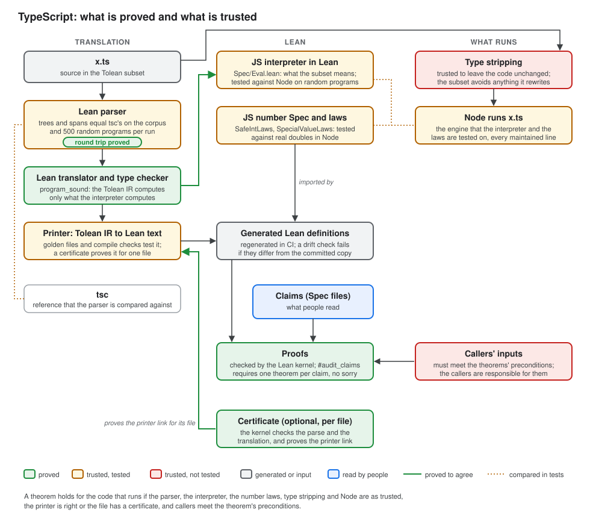

# TypeScript

Tolean translates pure TypeScript functions into plain Lean functions. This
page describes the parser, the translator, the subset it accepts, how it
models JS numbers, and what is proved and what is trusted. The
[README](../../README.md) describes the parts that all languages share.

[This graph](verification.svg) shows the verification chain for TypeScript. It
marks which links are proved, tested against a reference, or trusted.

## The translator

### Parsing

`tolean/TypeScript/Syntax/` puts a span on every node. It reads:

- **Declarations:** functions, with optional parameters such as `x?: T`,
  interfaces and type aliases, each of which may have type parameters such as
  `<A, B>`, enums whose members are strings, and `const` and `let`. Each of
  them may be exported, by `export` before it or by an export list such as
  `export { a, type B }`.
- **Statements:** `const` and `let` declarations, expression statements,
  `return`, `if` and `else`, `for … of`, the counted `for`, `while`, `switch`,
  blocks, `break`, `continue` and the empty statement. A counted `for`, such
  as `for (let i = 0; i < n; i++)`, starts with a `const` or `let`
  declaration or with nothing. A `break` at the top of a `switch`
  clause ends the `switch`, so it may stand outside a loop. The parser
  refuses a `case` test that uses `<` or `<<`, because a `:` does not end its
  search for a `>` after one, and a `switch` with two `default` clauses.
- **Expressions:** names; number, bigint, string, boolean and `null` literals;
  array and object literals, with shorthand and `key: value` properties;
  parentheses, member access, indexing and calls; the unary operators `!`,
  `-`, `+`, `~`, `typeof` and `void`; `++` and `--` before or after; the
  binary operators, including `??`, `**`, `in` and `instanceof`; the
  conditional operator; assignment, with every compound operator; arrow
  functions whose body is an expression, such as `x => x + 1` and
  `(a: number, b) => a * b`; and `e as const` and `e satisfies T`, which
  bind as `<` does, as they do in `tsc`.
- **Types:** keyword types such as `number`, `null`, literal types, named types
  with type arguments, arrays, tuples such as `[A, B]` and `readonly [A, B]`,
  unions and parentheses.

The translator accepts less than the parser reads; see
[The TypeScript subset](#the-subset). Sometimes `tsc` and JavaScript read the same tokens in two different
ways. When that happens, the parser refuses the code instead of choosing one
reading. There are three such cases:

- `f < A, B > (x)`. `tsc` reads type arguments, but JavaScript reads two
  comparisons.
- `(a)` followed by `{`. `tsc` reads an arrow function that is missing its
  `=>`, but JavaScript reads `(a); {`.
- `(a)`, then a line break, then `=>`. `tsc` reads an arrow function, but
  ECMA-262 allows no line break before `=>`, so JavaScript refuses the code.

The parser also refuses an arrow function with a return type, one whose body
is in braces, and one with an optional parameter: `(a?: T) => a` starts like
the conditional `(a ? …`. The translator accepts an arrow function only as the
callback of an array method, such as `xs.map(x => x + 1n)`.

In the declaration at the start of a counted `for`, the parser refuses an `in`
operator unless parentheses, braces, the arguments of a call or an index hold
it. ECMA-262 reads such an `in` as the start of a `for … in` loop. It allows
one inside `[ … ]`, but `tsc` does not, so the parser refuses that too. The
translator refuses every counted `for` for now.

`as const` and `satisfies T` have two more lookalikes, and the parser refuses
both:

- `<`, `<<`, `?`, `|`, `&`, `[`, `(` or `.` right after the type. `tsc` may
  read the token as a part of the type, as it reads `x as const < y` with type
  arguments. Type stripping leaves blanks in place of the type, so after a
  line break JavaScript may read the next line as a part of the operand, as
  in `x as const` and then `[0]` on the next line.
- `as` or `satisfies` right after a name that starts a declaration in `tsc`,
  such as `type` or `declare`. At the start of a statement, `tsc` reads
  `type as const` as a type alias.

The parser refuses every other type assertion, such as `x as T`, `<T>x` and
the non-null assertion `x!`, because TypeScript does not check them.

The parser also refuses code that Tolean cannot represent exactly. Examples
are lone surrogates, legacy octal literals, template literals and non-ASCII
names.

`tests/typescript/check.ts` checks the parser against `tsc`. To do this,
`tests/typescript/tscAst.ts` prints the tree from `tsc` in the same
S-expression form, and it refuses the node kinds that the Lean parser does not
read. The check covers three kinds of input:

- For `corpus/parse/accept/*.ts`, both parsers must accept the file, and the
  two trees must be equal, spans included.
- For `corpus/parse/reject/*.ts`, the Lean parser must refuse the file. The
  first line of each file gives the line, column and reason to expect.
- Each run also makes 500 random programs, with line breaks and comments
  between tokens. For each one, the trees must be equal, or both parsers must
  refuse it, or the Lean parser must refuse one of the lookalikes above. The
  run prints its seed, so you can replay a failure.

### Translation

`tolean/TypeScript/Translate.lean` translates the syntax tree. It does not
use `tsc`, so it types the subset itself. It gives every expression the type
that `tsc` would give it, with the same narrowing on `null`, and it refuses
anything it cannot type exactly. That type checker is part of what we trust.
The translator does not write text. It builds the Tolean IR, the Tolean
intermediate representation: the Lean code that it writes, as Lean data,
with types, expressions, bodies and declarations. `tolean/IR.lean` defines
the part of the IR that every language shares and prints it as Lean text.
`tolean/TypeScript/IR.lean` adds what only TypeScript needs: JavaScript
numbers and `null`. So a theorem can state what the
translator writes, which a proof of the translator needs. [The decision
record on the IR](../decisions/2026-10-30-tolean-ir.md) explains why it is a type of
Tolean's own rather than Lean's `Expr`.

`tolean/TypeScript/Proof/` proves the translator for every program that it
accepts. `tolean/TypeScript/IR/Eval.lean` gives the IR a meaning: it
evaluates the IR over the interpreter's values. The theorem `program_sound`
in `Proof/Module.lean` states that when the translator accepts every file of
a program, a function of the IR gives a value only when the interpreter
gives the same value for the same call.
`translate_sound` is the case of one file. It holds for every input,
every model of numbers and every amount of fuel. The theorem does not assume
that the types the translator gives are right. It is about the IR, so a
file without a certificate still trusts the printer link: the printed Lean
computes what the evaluator gives for the IR, and the evaluator gives a
value where the printed Lean does. The corpus tests the printer, and a
certificate proves the link for its file.

`tolean/TypeScript/Spec/Coverage.lean` lists every theorem about the subset
under the section of ECMA-262 that it is about, in the order of the spec, so
it shows which sections have theorems of their own. The theorems about no
section, such as those about the translator's monad or the parser, are in its
extras. The build fails when a theorem is in no list. `Spec/Coverage/` holds
a check for each rule that the interpreter or the translator once broke,
with one file for each chapter and one for the extras. A theorem states the
rule for every input, and a `#guard` checks one input. Every heading about the
spec has the form `§<number> <title> {#<anchor>}`, with the anchor of the
section in the spec, so a script can read the headings and compare them.

`tests/typescript/checkTranslate.ts` checks the translator. No second
translator checks its meaning, so these checks show that the output does not
change and still compiles; certificates prove more for the files they cover.

- `corpus/translate/accept/*.ts`: the translation must equal the committed
  `.lean` file beside it, and Lean must compile it. Run the check with
  `--update` to rewrite those files when a change to the output is meant, and
  review the diff. When the TypeScript translator in `npm/` that used `tsc`
  was removed, every one of these files equalled its output.
- `corpus/translate/reject/*.ts`: the translator must refuse the file. A line
  `// expect: <line>:<col> <part of the message>` says where and why. These
  files state in executable form what the subset refuses.
- In both, a line `// target: ES20xx` translates for that edition.
- Fuzz: 200 random typed programs per run, from a printed seed. When the
  translator accepts one, Lean must compile the output, and a second
  translation must give the same text.

#### Certificates

A certificate proves one file's translation, so that file no longer trusts
the translator. `tolean/TypeScript/Spec/Eval.lean` is an interpreter for the
subset: it runs the syntax tree that the parser returns, following ECMA-262.
For each function, `tolean certify` writes a theorem that the interpreter and
the translated Lean give the same result for every input:

```lean
theorem raise_cert (g : _) (step : _) :
    run program "raise" [(encGauge g), (Val.int step)] =
      some (encGauge (sensor.Raise.raise g step)) := by
  certify_tac [program, encGauge, sensor.Raise.raise]
```

```sh
tolean certify sensor/raise.ts sensor.Raise sensor.Raise sensor/RaiseCert.lean sensor.RaiseCert \
  --manifest sensor/Raise.lean.chain.json
```

Certificates are optional for now. `tolean translate --certify` writes the
certificate next to the translation, as `RaiseCert.lean` beside `Raise.lean`,
and records it in the manifest. Without `--certify`, `translate` writes only
the translation. In a project file, `"certify": true` asks for the same.

The command does not need to be trusted. If it writes a wrong encoding or a
wrong theorem, Lean refuses the file. The certificate also holds the
characters of the source, and it proves that the parser gives its program for
them: the kernel runs the parser on the characters and compares the trees. So
a certified file trusts the parser and the interpreter, instead of the
translator. With `--manifest`, the chain records this: the translator link
becomes `proved`, and so does the parse.

Every function of the subset can get a certificate. A `number` is a value of
the abstract model `JSNumber N` in the interpreter, as it is in the
translation, so each theorem holds for every `N`, real doubles among them,
and assumes none of the number laws.

A certificate's theorems follow from `translate_sound`, so they do not unfold
the interpreter. The certificate holds the IR that the translator gives,
and the kernel checks that the translator gives that IR for the program.
Then a `link` theorem for each function states that the printed definition
computes what the evaluator gives for the IR, and `decls_sound` in
`tolean/TypeScript/Proof/Link.lean` carries it to the interpreter. A loop gets
a lemma of its own: the evaluator runs the loop as the printed `List.foldl`,
for every environment whose variables have values of the right types. The
lemma follows from `runFold_foldl`, which Tolean proves once: when one run of
the body and one step of the fold agree, the loop and the fold agree. A loop
with a `break` runs as the printed `forIn` instead, and its lemma follows from
`runFold_forIn` in the same way, or from `runFold_forInRet` when a `return`
can end it.
`tests/typescript/checkCertify.sh` certifies each corpus file it can, and
`tests/chain/check.sh` checks that a wrong translation breaks a certificate.
Tolean also proves the parser's round trip. `parseChars_reads` in
`tolean/TypeScript/Syntax/RoundTripText.lean` states that the parser reads
the printed source of every module that it gives as the same module, apart
from spans. The proof has these parts. Each compares trees apart from spans,
and a well-formed tree is one that has the shape that the parser reads.

| What it states | Theorem | File in `tolean/TypeScript/` |
|---|---|---|
| The parser reads the printed tokens of every well-formed type as that type, given fuel for how deep the type nests. | `types_reads` | `Syntax/RoundTrip.lean` |
| The same for each level of the expression parser, when the target edition has the operators that the expression uses. | `exprs_read` | `Syntax/RoundTripExpr.lean` |
| The same for statements, in a function or not and in a loop or not. | `stmts_read` | `Syntax/RoundTripStmt.lean` |
| `parseModule` reads the tokens of the printed lines of every well-formed module, which the end of the file follows, as that module. | `module_reads` | `Syntax/RoundTripDecl.lean` |
| Every module that the parser gives is well formed, and each word that it prints is one that the lexer reads back. | `parseTokens_wf` | `Syntax/ParseWF.lean` |
| The lexer reads the printed source as the tokens of the printed lines, with the line breaks that `Laid` states. | `lexChars_render` | `Syntax/RoundTripLex.lean` |
| The printer puts a line break inside a line only before a `(`. | `Module.breaksOK` | `Syntax/RoundTripText.lean` |

#### Effects (planned)

Tolean refuses most calls to libraries with side effects today.
[The effects plan](../plans/effects.md) describes how the translators will
share one mechanism for them. Each library declares its effects in a small
file, and the declarations fix a trust boundary that a later proof of the
library removes.

#### Names

A source name never hides a Lean name that the output uses. Before it
translates a file, the translator collects every identifier in it. When the
file declares a name that the output also uses, such as `List`, `Option`,
`some`, `none`, `decide`, `Int`, `Bool`, `JSString` or `JSNumber`, the output
writes the Lean name in full from the root, as `_root_.List` or
`_root_.Option.none`. The source name stays as it is, so a claim refers to
it by the name in the source. The number type parameter is `N`, or `N1`,
`N2` and so on when the file uses `N`. Both translators follow this rule, and
`corpus/translate/leanNames.ts` checks it. A Lean keyword, such as `def` or
`where`, is still refused as a name.

### Imports

A file may import the exported functions, interfaces and type aliases of
other files of the project:

```ts
import { clamp, type Gauge } from "./lib/util.ts";
```

- An import names the file by a relative path with its `.ts` extension, such
  as `"./util.ts"`. Node's type stripping needs that extension, and a bundler
  accepts it, so the import names the same file wherever the code runs.
  Tolean refuses `"./util.js"` and `"./util"`. Node reads a source as a URL,
  so Tolean also refuses a source with `%`, `?`, `#` or `\`, and one such as
  `"./util.ts/."` that names a directory there. The file must be among the
  sources of `tolean.json`, and its edition may not be newer than the
  importing file's.
- An interface or a type alias needs `type`, either before its name or as
  `import type`.
  Node's type stripping removes only imports that say `type`, so without it
  the JavaScript would import a name that does not exist at run time.
- Only named imports are supported. Tolean refuses `as`, a default or
  namespace import, an import with no names or for its side effects, a
  re-export such as `export { a } from "./x.ts"`, and an import cycle.
- An export list, such as `export { clamp, type Range }`, exports
  declarations of the file, as `export` before each of them would. It may
  name only functions, interfaces and types that the file declares before the
  list and does not export already, and no name twice. An interface or a type
  needs `type`, and a function may not have it, because Node's type stripping
  removes exactly the names that say `type`. The output does not change,
  because the names stay in scope. Tolean refuses `as` in an export list, and
  `export *`.
- A function or an interface may not be named `NaN`, `Infinity` or `Number`,
  because it would hide the global that the subset reads under that name.
- A local may not have the name of a function that the file declares or
  imports, or of `NaN`, `Infinity` or `Number`. In JavaScript the local is
  in its temporal dead zone from the start of its block, so a use of the
  name before the local throws, where the subset would read the function or
  the global. A parameter or a local may not have the name of an interface
  of the file either, because Lean, unlike TypeScript, would read the type
  as the local.
- No two files of a project may have namespaces that are equal or nested,
  such as `A` and `A.B`. Inside `namespace A.B`, Lean finds a plain name such
  as `decide` in `A` before the root, so one file's declarations could change
  what another file's output means.

`tolean translate` translates the files of a project so that each file comes
after the files it imports from. Each file becomes its own Lean module, with
an `import` line for each file that it imports from. The module's name comes
from the output's path, from the directory that `moduleRoot` names, or from
the directory of `tolean.json` by default. Each file's manifest lists the
files it imports from among its sources. The output writes a name
from another file from the root, with that file's namespace, such as
`_root_.lib.Util.clamp`, so that a local name cannot capture it. A file may
read and build the fields of an interface that reaches it through another
interface's fields, without importing it. A file
that imports from a file that uses the number model uses it too, so that it
has a number type to pass. The command for one file,
`tolean translate <file>`, refuses an import, because it does not see the
other files.

The interpreter runs a program of several files, and a call runs the function
that its file declares or imports under that name. `program_sound` covers
such programs. A file with imports has no certificate yet.
`corpus/translate/projects/` holds projects that the translator must accept
and compile, and projects that it must refuse.

## The subset

The TypeScript translation is a shallow embedding, which means it maps
TypeScript constructs straight to Lean constructs. That is sound only for code
that cannot alias mutable state. For this reason, the subset lets a function
change only the locals that it owns. Tolean rejects anything else and reports
the file, the line and the reason. It never approximates.

| TypeScript | Lean |
|---|---|
| `bigint` | `Int` (exact; literals are typed `(n : Int)`) |
| `number` | an abstract `N` with `[JSNumber N]` (see [Numbers](#numbers)) |
| integer `number` literal, `-x`, `+ - *`, `< <= > >=`, `=== !==` on `number` | `JSNumber.ofSafeInt`, `neg`, `add`, `sub`, `mul`, `lt`, `le`, `eq` |
| `Number.isSafeInteger(x)` | `(JSNumber.toSafeInt x).isSome` |
| `Number.isNaN(x)`, `Number.isFinite(x)` | `JSNumber.isNaN x`, `JSNumber.isFinite x` |
| `NaN`, `Infinity`, `-Infinity` | `JSNumber.nan`, `posInf`, `negInf` |
| `T \| null`, `null` | `Option T`, `none` |
| `x === null`, `x !== null` | `x.isNone`, `x.isSome` |
| `x == null`, `x != null` | the same as `===` and `!==`, because a value of `T \| null` is never `undefined` |
| `x === null \|\| e`, `x !== null && e` | `match x with \| none => … \| some x => e` (TypeScript's narrowing) |
| `a ?? b` on `T \| null`, where `b` is a `T` | `Option.getD a b` |
| `a ?? b` on `T \| null`, where `b` may be `null` | `Option.or a b` |
| `boolean` | `Bool` |
| `string`, `"abc"` | `JSString`, `JSString.ofString "abc"`. A `JSString` holds the UTF-16 code units of the string, as ECMA-262 defines a string, so a value can hold a lone surrogate, which a Lean `String` cannot. `ofString` is injective, so a claim can state a literal as a Lean `String`. |
| `ReadonlyArray<T>`, `Array<T>`, `T[]` | `List T` |
| `interface` with `readonly`, required fields | `structure` |
| `readonly f?: T`, an optional field | `f : Option T := none`. An object literal may leave the field out, or set it to a `T`. A read of a field that the object lacks gives `undefined`, which is `none`. `s.f ?? d` is `Option.getD s.f d`, and `s.f === undefined` is `s.f.isNone`. |
| `x?: T`, an optional parameter | `(x : Option T := none)`. A call may leave out the optional parameters, which come last, and then the output passes `none` for each. A call may also pass a `T`, or `undefined`, which is `none` too. `x ?? d`, `x === undefined` and `x?.f` work as they do on an optional field. |
| `if (x === undefined)` or `if (x !== undefined)`, with `undefined` on either side, where `x` is an optional parameter or a local with an optional value | `match x with \| none => … \| some x => …`, as for a test of `null`. The branch where `x` is defined reads it as a `T`. |
| `p?.f`, where `p` is a `S \| null` or an optional field of type `S` | `p.map (·.f)`, or `p.bind (·.f)` when `f` is optional. The value is `undefined` when `p` is `null` or `undefined`, so it has the type of an optional field: `p?.f ?? d` and `p?.f === undefined` work as they do on `s.f`. |
| `e as const` and `e satisfies T` | `e`. Type stripping removes both, so the value is the value of `e`. Tolean types `e` in the context of `T` and checks that the value has the type `T`, as `tsc` does. The value keeps its own type, which can be wider than the type `tsc` gives it, because the output types a literal by its context, as it does without `as const`. |
| `p?.f.g`, a chain of reads after `?.` | `p.map (·.f.g)`, or `p.bind (·.f.g)` when `g` is optional. The reads after `?.` are a part of the same optional chain, so the whole chain is `undefined` when `p` is `null` or `undefined`. Each field before the last must be a required field of an interface type. |
| `type T = U`, declared before its uses | `abbrev T := U`. The output writes `U` itself wherever the source names `T`, so the `abbrev` is only for claims. |
| `type T = 'a' \| 'b'`, a union of string literals | `inductive T` with the constructors `a` and `b`, which derives `DecidableEq`. A literal becomes `T.a` where the context expects a `T`, and `t === 'a'` becomes `t = T.a`. The output writes every constructor in `«»`, such as `T.«open»`, because Lean reads some strings as keywords or modifiers. A claim can still write `T.a`. |
| `enum T { A = 'a', B = 'b' }`, an enum whose members are strings | The same `inductive T` as for `'a' \| 'b'`, with the constructors named after the strings, so `T.A` becomes `T.«a»`. TypeScript compiles the enum to an object with one property for each member, and `T.A` reads it. The output has no such object, so only `T.A` reads a member, and a file that imports the enum without `type` may read its members too. |
| `type T = A \| B`, a union of interfaces with a tag field such as `kind: 'circle'` | `inductive T` with a constructor for each member, which holds the member's structure. The structure leaves the tag field out, because its value never changes. An object literal where a `T` is expected becomes the constructor of its tag. |
| `if (s.kind === 'circle')`, with `===` or `!==` and the string on either side | `match s with \| T.circle s => … \| …`. TypeScript narrows `s` in each branch, and so does the output. A chain of such tests on the same value becomes one `match`. |
| `switch (s.kind)` with a `case 'circle':` for each member, or a `default:` last, where every clause returns | The same `match`, with one arm for each case. The `default`, or the code after the `switch` when it has no `default`, becomes the arm for the members that no case names. |
| The same `switch`, where every clause changes locals and ends in `break` | `let (x, y) := match s with …`, as for an `if` that changes locals. The last clause may leave out its `break`. Without a `default`, the arm for the members that no case names keeps the locals as they are. In a loop body, the `match` is the step of the `List.foldl`. |
| The same `switch`, where the cases cover every member and a last `default: { const x: never = s; … }` checks it | The same `match`, without the `default`. TypeScript accepts the check only where no member is left, so the clause never runs. The statements after the check are not translated. In a `switch` whose clauses end in `break`, the last case needs its `break`, because without it the case would run into the `default`. |
| `type T = string \| bigint`, a union of two or more of `string`, `number`, `bigint` and `boolean` | `inductive T` with a constructor for each member, which holds a value of its type, such as `T.string (value : JSString)`. The constructor is named after what `typeof` gives for the value. A value of a member where a `T` is expected becomes that member's constructor. |
| `if (typeof x === 'string')`, with `===` or `!==` and the string on either side, where `x` is a local of such a union | `match x with \| T.string x => … \| …`, which narrows `x` as a test of a tag does |
| `type R = Record<K, V>` or `Readonly<Record<K, V>>`, where `K` is a literal union of strings | `structure R` with one field of type `V` for each string of `K`, in the order of `K`. A value has a property for each string, so an object literal must set every key, in that order, as for an interface. `r.a` and `r['a']` read a field. |
| `r[k]`, where `r` is such a `Record` and `k` has the type `K` | `match k with \| K.a => r.a \| …`, which reads the field that `k` names |
| `function` with typed parameters and return type | `def` |
| `const x = e`, `let x = e` | `let x := e` |
| `x = e`, `x += e`, `x -= e`, `x *= e` on a `let` local | `let x := …` (shadowing) |
| `x ??= e` on a `let` local of type `T \| null` | `let x := Option.or x e`. JS evaluates `e` only when `x` is `null`. Lean evaluates it either way, but the result is the same, because the subset has no side effects. |
| `[a, b]` with the element type from the context or the elements, such as `return [a, b]` or `const xs: ReadonlyArray<T> = []` | `([a, b] : List T)` |
| `[A, B]` and `readonly [A, B]`, a tuple of two elements or more | `A × B`. In JS a tuple is an array. |
| `[a, b]` where the context expects a tuple, such as a return value | `(a, b)`, with each element translated where its own type is expected |
| `t[0]`, an element of a tuple at an index that is a number literal | `t.1`, and `t.2.1` or `t.2.2` for the second or the last of three, as Lean nests the product to the right |
| `const xs: Array<T> = [...]`, then `xs.push(e)`; `xs` read only in the `return` | `let xs := xs ++ [e]` |
| `for (const x of xs) { … }` | `List.foldl` over the tuple of locals the body changes |
| `if (c) continue;` at the top of a loop body, or a branch of that `if` that ends in `continue` on every path | `if c then (x, y) else …`, where the rest of the body is the `else` branch, as after an `if` that returns. A test of `null` or of a tag narrows the local for the rest of the body. |
| `break` in a `for (const x of xs)` loop, in the same places as `continue` | `Id.run (forIn xs (x, y) (fun e (x, y) => …))`. A `break` is `ForInStep.done (x, y)`, which ends the loop, and the end of the body or a `continue` is `ForInStep.yield (x, y)`. A loop without a `break` stays a `List.foldl`. |
| `return e` in the same places, in a loop where the statements after it end in a `return` | `match Id.run (forIn xs (none, x, y) (fun e (_, x, y) => …)) with`, with the arms `\| (some r, _) => r` and `\| (none, x, y) => …` for the statements after the loop. The state starts with the value to return: a `return e` is `ForInStep.done (some e, x, y)`, and the other step ends hold `none`. |
| `xs.map(x => e)`, `xs.filter(x => p)` | `List.map (fun (x : T) => e) xs`, `List.filter (fun (x : T) => p) xs` |
| `xs.map((x, i) => e)` | `List.mapIdx (fun (i : Nat) (x : T) => let i := JSNumber.ofSafeInt i; e) xs`. JS passes the index as a number, so the body reads `i` as a `number`. An array has fewer than 2^32 elements, so the index is always a safe integer. |
| `xs.some(x => p)`, `xs.every(x => p)` | `List.any xs (fun (x : T) => p)`, `List.all xs (fun (x : T) => p)` |
| `xs.find(x => p)` | `List.find? (fun (x : T) => p) xs`. The value is `undefined` when no element passes, so it has the type of an optional field: `xs.find(p) ?? d`, `xs.find(p)?.f` and `xs.find(p) === undefined` work as they do on `s.f`. |
| `xs.findLast(x => p)` | `List.find? (fun (x : T) => p) (List.reverse xs)`, which the callback reads from the last element to the first, as in JS. It has the type of `find`, and it is in ES2023. |
| `xs.findIndex(x => p)` | `JSNumber.ofSafeInt (((List.findIdx? (fun (x : T) => p) xs).map Int.ofNat).getD (-1))`: the index of the first element that passes, as a `number`, or `-1` |
| `xs.reduce((acc, x) => e, init)` | `List.foldl (fun (acc : A) (x : T) => e) init xs`, where `A` is the type of `init`. The body must give a value of that type. |
| `if` that returns, `if` that changes locals, `c ? a : b` | `if … then … else …` |
| `+ - *`, `< <= > >=`, `=== !==`, `&& \|\| !` | the same operators on `Int`, `Bool`, `Prop` |
| `a / k`, `a % k` on `bigint`, where `k` is a nonzero literal | `Int.tdiv a k`, `Int.tmod a k` (both truncate toward zero, as JS does) |
| `{ a, b: e }` building a declared interface | structure instance |
| Call to a function declared earlier in the file | application |
| `interface Box<T> { readonly value: T }`, where the type parameters have no constraint | `structure Box (T : Type)`. `Box<bigint>` becomes `Box Int`, and a read of a field has the field's type with `bigint` for `T`. An object literal where a `Box<bigint>` is expected becomes `({ value := … } : (Box Int))`. |
| `type Maybe<T> = T \| null` | `abbrev Maybe (T : Type) := Option T`. As for any alias, the output writes the type itself wherever the source names it, so `Maybe<bigint>` becomes `Option Int`. |
| `function f<T>(x: T): T`, where the type parameters have no constraint | `def f {T : Type} (x : T) : T`. A call fixes each type parameter from the types of its arguments, and Lean infers the same types. An argument of `T \| null` may be `null`, which leaves `T` to another argument. |

Tolean rejects these, among others:

- Fractional or unsafe `number` literals, such as `0.5` and `2 ** 53`. It also
  rejects `/`, `%` and `Math.*` on `number`, because no law covers them yet.
- `/` and `%` on `bigint`, unless the divisor is a nonzero literal. JS throws
  an error when the divisor is `0n`, but `Int.tdiv` returns 0.
  `tests/typescript/bigintDivision.test.ts` checks on random pairs that JS
  `/` and `%` agree with `Int.tdiv` and `Int.tmod`.
- `===` on objects, because in JS it compares references. It also rejects
  `===` between nullable values.
- `==` and `!=` anywhere except in a test against `null`. Between two other
  values they convert their operands, as in `0 == ""`, and the subset does
  not model that.
- A test with `null` whose answer the type fixes, such as `x === null` after
  `if (x === null) return …`. The test does nothing, so the code means the
  same without it. Refusing it keeps every part of the program in the
  translation, which the proof of the translator relies on. For the same
  reason Tolean refuses `a ?? b` when `a` cannot be `null`.
- A local of type `null`, such as `let x = null`. Lean would give it the type
  `Option Empty`, which no other value has. Write the type instead, as in
  `let x: bigint | null = null`.
- `x ??= e` where `x` is a `const`, or where its type does not include `null`.
- The global `isNaN` and `isFinite`. These convert their argument to a number
  first. Use `Number.isNaN` and `Number.isFinite` instead.
- Assignment to a parameter, a `const` or a field, and a push onto an array
  that the function did not create. A `continue`, a `break` or a `return`
  must end the loop body, or a branch of an `if` at the top of the body; code
  after the `if` must then go in its `else` branch, if it has one. A `return`
  in a loop also needs the statements after the loop to end in a `return`, so
  Tolean rejects it in a loop inside another loop or in a branch that changes
  locals. An assignment to a `const` throws a `TypeError`, so
  the interpreter gives no value for a block where a statement after a
  `const` assigns it, and the translator refuses the `const`.
- A read of an owned array anywhere except in the `return` value. If code
  kept an alias, stored the array in a field or looped over it, it would miss
  a later push. In Lean a push makes a new list, but in JS it changes the
  shared one. An array literal is safe anywhere else: in JS it makes a new
  array, and nothing may push to an array that the function does not own.
- An arrow function anywhere except as the callback of `map`, `filter`,
  `some`, `every` and `find`, and a named function as a callback. A callback
  of `map` may take the index as its second parameter. The other callbacks
  take one parameter, and no callback may take the array, which JS passes
  too. A later step will translate those. The body of a callback must not assign, and
  for every method but `map` it must give a boolean. Tolean also refuses
  `find` on an array of nullable values, because Lean's `none` would stand
  for both `null` and `undefined`.
- `reduce` without an initial value, which throws on an empty array, and a
  callback of `reduce` whose value has another type than the initial value.
- An array declared with `let` and the type `Array<T>`. An array that the
  function pushes to must be a `const`; for a value, use `ReadonlyArray<T>`.
  An empty `[]` needs a type from its context, and the elements of a literal
  need one type.
- A tuple of one element, an empty tuple, named, optional and rest elements,
  and a `,` after the last element. Tolean also refuses `readonly` before
  anything but a tuple, such as `readonly bigint[]`, and `readonly [A, B][]`,
  which `tsc` reads as a readonly array of tuples. An index of a tuple must be
  a number literal within the tuple, and an index of any other value is
  refused. `===` on tuples is refused, because in JS it compares the arrays
  by reference.
- A type parameter with a constraint, a default or a modifier, and a `,` after
  the last one. Tolean also refuses a type parameter of a function that no
  parameter's type names, because a call could not fix it. A generic type
  named with the wrong number of type arguments is refused, and so is a
  generic union or `Record`: a union of string literals, primitive types or
  interfaces, and a `Record`, become a type of their own, which takes no type
  parameters. A
  field may not have the name of a type parameter, because Lean would read the
  name as the field in the types of the fields after it. A type parameter may not have the
  name of a type or function of the file, or of a local, because Lean would
  read the name as the other one. `===` on values of a type parameter is
  refused, because in JS it compares objects by reference.
- A call to a generic function whose arguments do not fix every type
  parameter, or fix one to `null`, a nullable type or an optional field's
  type. The output gives `T | null` the type `Option T`, so `T` may not be
  nullable itself.
- A literal union that is not the whole of a type alias, such as `(s: 'a' | 'b')`,
  because the output needs a name for its inductive type. Tolean also refuses
  a union of string literals and other types, a string that is not an ASCII
  name or that Lean declares for every inductive type, such as `'rec'`, and a
  value of a literal union where a `string` is expected.
- A numeric enum, an enum member without a value, a `const enum`, and an enum
  inside a function. Tolean also refuses an enum without members, two members
  with one name or one string, and a member named after a property of
  `Object.prototype`, such as `__proto__`. In TypeScript a value of a string
  enum is one of its members, so Tolean refuses a string such as `'a'` where
  the enum is expected, and a member where a `string` is expected. It also
  refuses the enum's object as a value, and a local with the enum's name.
- A field of a tagged union read before a test of its tag, a read of the tag
  field outside such a test, and a union of interfaces without a tag. Tolean
  also refuses a member, such as a `Circle`, where the union is expected,
  except as an object literal. Where a test leaves more than one member, a
  further test of the same value must come first in the other branch, as in
  a chain of `if (s.kind === 'a') return …`, so that Lean sees one `match`
  that covers every member.
- A `switch` that does not test the tag of a tagged union, and fallthrough:
  each clause must end in `return`, or each in `break`. A clause that ends in
  `break` may not return, and may not break or continue before its end.
  Tolean also refuses a `default` that is not the last clause, and one that
  no member can reach unless it assigns the local to `never`. It refuses a
  `default` that assigns the local to `never` while a member is left, a
  first clause that is a `default`, a case that an
  earlier case already takes, an assignment to the local that the `switch`
  tests, and code after a `switch` whose cases cover every member and
  return.
- A `const` or `let` at the top of a `case` clause, outside braces. The
  clauses share one scope, so two clauses may not declare the same name, and
  a clause that runs first cannot read an outer name that a later clause
  declares. Put the clause in braces: `case 'a': { const n = 1n; return n; }`.
- A union of primitive types that is not the whole of a type alias, such as
  `(x: string | bigint)`, because the output needs a name for its inductive
  type. A union of primitive types and `null` needs that name too: declare
  `type T = string | bigint`, then write `T | null`. Tolean also refuses
  `typeof` anywhere except in the test of an `if` on a local of such a
  union, against one of its members. So it refuses `typeof` on a union of
  interfaces, on a value that may be `null`, and as a value, as in
  `return typeof x === 'string'`.
- A `Record` that is not the whole of a type alias, such as
  `(r: Record<K, V>)`, because the output needs a name for its structure.
  Tolean also refuses `Record<string, V>` and other keys that are not a
  literal union of strings, index signatures, and a key that Lean reserves,
  such as `'def'`. It refuses an index into anything but such a `Record`, an
  index whose key does not have the type `K`, and an index in a file that
  does not declare or import `K`, because the output names the constructors
  of `K`. Code that needs keys of type `string` can use a `Map` once Tolean
  translates it.
- An object literal whose fields are not in the order that the interface
  declares them. A JS object keeps its keys in the order the literal writes
  them, and a caller can see that order through `Object.keys` or
  `JSON.stringify`. A Lean structure has no order, so the literal must use
  the declared one. Code in the subset can only read a field by name, so
  inside the subset the order never changes a result.
- An optional field that is also nullable, a tag field that is optional, and
  an optional field with the name of a property of `Object.prototype`, such
  as `toString`, because an object without the field has that property.
  Tolean also refuses `undefined` as a value, except as the argument of an
  optional parameter. So a literal must leave an optional field out rather
  than set it to `undefined`, or to the value of another optional field. JS
  tells an object without the key from one whose key holds `undefined`, and
  Lean has one `none` for both. It also refuses `== null` and `=== null` on
  an optional value, and `== undefined`.
- An optional parameter that is also nullable, and a required parameter after
  an optional one. Tolean also refuses `T | undefined` as a type, and a test
  of `undefined` that narrows a value inside an expression, such as
  `x !== undefined && x > 0n`. Only the test of an `if` narrows an optional
  value.
- `?.` where the value cannot be `null` or `undefined`, `?.` on a nullable
  field, and `a?.[i]` and `f?.()`. In a chain such as `a?.b.c`, Tolean
  refuses a field before the last that may be `null` or `undefined`, because
  `.` on it throws. `(a?.b).c` is not a chain, because the parentheses end
  it: it reads `.c` of `undefined` when `a` is `null`, so Tolean refuses
  it.
- A local or a function named `undefined`, which would hide the global the
  subset reads. Tolean also refuses a value that may be either `undefined` or
  `null`, such as `b ? s.f : null`, because the output has one `none` for
  both.
- A `__proto__: v` key in an object literal. It sets the object's prototype,
  not a field.
- Recursion, closures and arrow functions, classes, `async`, exceptions, and
  mutable interface fields.
- Imports other than the named imports of [Imports](#imports).

The files in `tests/typescript/corpus/translate/reject/` state in executable
form what the translator refuses. To see what that does and does not guarantee,
read [What is proved and what is
trusted](#what-is-proved-and-what-is-trusted).

## Numbers

A JS `number` is an IEEE-754 double. Tolean does not map it to Lean's
`Float`, because then the code would run in Lean, but you could not prove
anything about it. Lean's `Float` is an opaque wrapper around C doubles. Its
operations are `extern` functions that come with no lemmas, so even
`(1.0 : Float) + 1.0 = 2.0` has no proof without `native_decide`. You could
prove only facts that hold for any type, such as "the result is one of the
inputs".

Aeneas has the same problem with Rust's `f64`, and it does not support floats
yet ([AeneasVerif/aeneas#828](https://github.com/AeneasVerif/aeneas/issues/828)).
The discussion there shows two ways that things go wrong. First, float
literals and arithmetic fail to translate. Second, code that only passes an
`f64` along translates to a Lean type `F64` that the Aeneas library never
defines. Because Lean's `autoImplicit` option is on by default, that name
silently becomes a type variable. One proposed fix maps `f64` to Lean's
`Float`. With that fix the code runs, but you still cannot reason about the
arithmetic.

Tolean takes a different approach. Every definition that uses `number` is
generic over an abstract number type `N`, which has the operations of the
`JSNumber` class in `tolean/TypeScript/Spec/Number.lean`. Proofs can use this
at three levels:

- **Nothing assumed.** A theorem that you prove for every `N` also holds for
  real doubles. This level is enough for facts that do not depend on
  arithmetic.
- **Safe integers.** `toSafeInt : N → Option Int` returns the integer that a
  value is, when `Number.isSafeInteger` holds for it. `SafeIntLaws` states
  two facts about safe integers. JS arithmetic on them is exact as long as
  the result stays in range, and comparison on them agrees with `Int`. A
  theorem that needs this takes `[SafeIntLaws N]` and hypotheses such as
  `toSafeInt x = some i`. Then it reasons over `Int`.
- **`NaN` and `±Infinity`.** `isNaN`, `isFinite`, `nan`, `posInf` and `negInf`
  model `Number.isNaN`, `Number.isFinite`, `NaN` and `±Infinity`.
  `SpecialValueLaws` states how they behave. `===` is symmetric, and it is
  reflexive for every value except `NaN`, so `x !== x` tests for `NaN`.
  `NaN` fails every comparison and spreads through `+`, `-` and `*`.
  `±Infinity` bound every finite number, and `Infinity - Infinity` is `NaN`.
  A theorem that needs these facts takes `[SpecialValueLaws N]`.

The laws are hypotheses, not Lean axioms. If one of them were false, the
theorems that use it would not apply to JS. But Lean would stay consistent,
and every other theorem would still stand.

Lean cannot check facts about the JS engine. Instead,
`tests/typescript/jsNumberLaws.test.ts` checks each law against real doubles,
including the range limits, `±0`, subnormal numbers, `NaN` and `±Infinity`.
Each check records the exact Lean statement that it was written for, so
nobody can change a law without also changing its check.

`tolean/TypeScript/Spec/Lemmas/Number.lean` contains facts that we proved from
the laws, and any project can reuse them. Examples are reflexivity on safe
integers and `eq a a = !isNaN a`. These facts assume nothing new, so they need
no audit.

## Versions

Each translation is for one **target**, which is the ECMAScript edition that
the code runs on. Tolean translates the source as it runs, because type
stripping keeps the syntax unchanged. This means the engine must support every
feature that the code uses. It also means that the translation must assume the
meaning that the target edition specifies.

```sh
tolean translate --target ES2022 input.ts Output.lean My.Namespace
```

- The target can be any edition from ES2015 to ES2025. The default is ES2024,
  because that is what Node 22 supports, and Node 22 is the oldest release
  line that is still maintained. We add a new edition only after we review
  what it changed.
- `tolean/TypeScript/Edition.lean` lists each JS feature that Tolean relies
  on. For each feature, it gives the first edition that specifies it and the
  ECMA-262 production or operation that defines it. It uses names instead of
  section numbers, because section numbers move between editions. The parser
  and both translators refuse a feature that is newer than the target, and
  they all give the same message:

  | Feature | Since |
  |---|---|
  | `**`, `**=` | ES2016 |
  | bigint (literals, type, `+ - *`, comparisons) | ES2020 |
  | bigint `/` and `%` (`BigInt::divide`, `BigInt::remainder`) | ES2020 |
  | `??` | ES2020 |
  | `?.` | ES2020 |
  | `&&=`, `\|\|=`, `??=` | ES2021 |
  | numeric separators (`1_000`) | ES2021 |

  The number laws hold in every edition. If a later edition changes how
  something behaves, we add a new feature for the new meaning. We never give
  one feature a second meaning.
- Every generated file starts with the Tolean release and the target, for
  example `-- Generated by tolean 0.3.0 for ES2024 from x.ts.` That way, the
  drift check notices when either one changes. A change to the meaning of a
  law is a major release. A new law, model or feature is a minor release.
- We test the laws on every engine listed in `engines` in `flake.nix`, which
  are Node 22 and Node 24. Run `nix run .#test-engines`. A law holds only for
  the engines that it passes on.

## The npm package

`npm/` is the `tolean` package on npm. It contains the `tolean` command, the
`translateSource` and `translateWorkspace` functions, and the Lean runtime in
`lean/`. All of them run the native `tolean` binary for the platform, which
`.github/workflows/release.yml` builds with Lean's own toolchain for each
platform that Lean supports. Each binary is its own package, such as
`@tolean/darwin-arm64`, and npm installs only the one for the platform. To
run another binary, such as one that Lake built, set `TOLEAN_BINARY` to its
path. `translateSource` returns a promise, because it runs the binary as a
child process. The package's README is this repository's README, which the
npm build copies with each relative link made absolute.

```sh
tolean <input.ts> <output.lean> <Lean.Namespace>
```

Generated code that uses `number` imports `tolean.TypeScript.Spec.Number`.
To use it, require the runtime by path:

```toml
[[require]]
name = "tolean"
path = "node_modules/tolean/lean"
```

## What is proved and what is trusted



| Step | What happens | Status | How it is checked |
|---|---|---|---|
| 1. Parse and type-check | Tolean's parser reads the source, and the translator types the subset itself | Trusted, tested | `tests/typescript/check.ts` compares the parser's syntax trees with `tsc`'s, on the corpus and on random programs. It also prints each tree as source and requires the parser to read it as the same tree. `parseChars_reads` proves this second check for every tree that the parser gives. The proof shows that the parser and the printer agree, but not that the parser reads TypeScript as `tsc` does. The type checker is tested through the translation corpus. |
| 2. Translate | Tolean writes readable Lean definitions (the generated `.lean` files) | **Proved** up to the printer | `program_sound` proves the translation to the Tolean IR for every accepted program: when the IR's evaluator gives a value, the interpreter gives the same value. The printer link is trusted: that the printed Lean computes what the evaluator gives for the IR, and that the evaluator gives a value where the printed Lean does. No theorem can state it for every program, because the printed Lean is text that means something only after Lean compiles it. The golden files of the corpus, compiling random programs and the CI drift check test it, and a [certificate](#certificates) proves the link, and so the whole step, for one file. |
| 3. Prove the claims | Hand-written proofs show that each claim in `Spec/*.lean` holds for the generated definitions | **Proved** | The Lean kernel, `#audit_claims`, `lake build --wfail`, and no `sorry`, `admit`, `axiom` or `native_decide` |
| 4. Assume JS number facts | `SafeIntLaws` and `SpecialValueLaws` in `tolean/TypeScript/Spec/Number.lean` | Trusted, tested | `tests/typescript/jsNumberLaws.test.ts` checks each law against real doubles. |
| 5. Run | Type stripping or a bundler makes the JavaScript that Node runs | Trusted | The subset uses only constructs that type stripping leaves unchanged, except `enum`. Type stripping refuses an enum, so code with one needs `tsc`, a bundler or Node's `--experimental-transform-types`. The interpreter reads an enum as the object that `tsc` makes for it. |
| 6. Inputs | The code that calls the verified functions passes inputs that meet the theorems' preconditions | Trusted | The callers are responsible for it. A function can check its own inputs instead, so that its claim has no precondition, and [a plan](../plans/input-checks.md) lets `tolean.json` require that. |

So a theorem holds for the code that runs if steps 1, 4 and 5 are correct, the
printer of step 2 is correct or the file has a certificate, and the inputs meet
its preconditions. These goals are not built yet:

| Goal | Purpose | Today |
|---|---|---|
| The parser against the grammar | Prove that the parser reads TypeScript as the language's grammar does, so that step 1 stops being trusted. The round trip proves only that the parser and the printer agree. | Not started. `tests/typescript/check.ts` tests the parser against `tsc`. |
| The interpreter from a formal semantics | Derive `eval` from a formal semantics of ECMA-262, so that it stops being a trusted specification | Not started. `tests/typescript/interpreter.test.ts` tests it against Node. |
