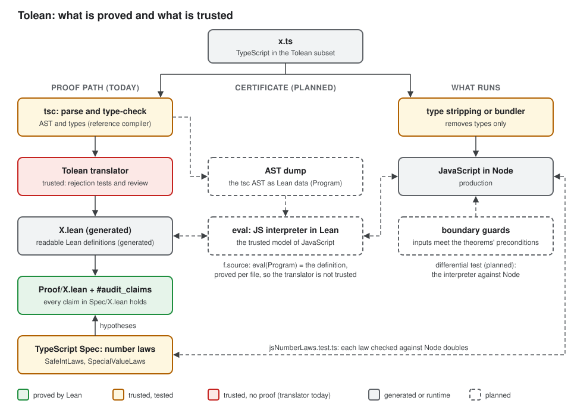

# TypeScript

Tolean translates pure TypeScript functions into plain Lean functions. This
page describes the parser, the translator, the subset it accepts, how it
models JS numbers, and what is proved and what is trusted. The
[README](../../README.md) describes the parts that all languages share.

[This graph](verification.svg) shows the verification chain for TypeScript. It
marks which links are proved, tested against a reference, or trusted.

## The translator

### Parsing

`tolean/TypeScript/Syntax/` puts a span on every node. It reads:

- **Declarations:** functions, interfaces, type aliases, and `const` and `let`,
  each of them possibly exported.
- **Statements:** `const` and `let` declarations, expression statements,
  `return`, `if` and `else`, `for … of`, `while`, blocks, `break`,
  `continue` and the empty statement.
- **Expressions:** names; number, bigint, string, boolean and `null` literals;
  array and object literals, with shorthand and `key: value` properties;
  parentheses, member access, indexing and calls; the unary operators `!`,
  `-`, `+`, `~`, `typeof` and `void`; `++` and `--` before or after; the
  binary operators, including `??`, `**`, `in` and `instanceof`; the
  conditional operator; and assignment, with every compound operator.
- **Types:** keyword types such as `number`, `null`, literal types, named types
  with type arguments, arrays, unions and parentheses.

The translator accepts less than the parser reads; see
[The TypeScript subset](#the-subset). Sometimes `tsc` and JavaScript read the same tokens in two different
ways. When that happens, the parser refuses the code instead of choosing one
reading. There are two such cases:

- `f < A, B > (x)`. `tsc` reads type arguments, but JavaScript reads two
  comparisons.
- `(a)` followed by `{`. `tsc` reads an arrow function that is missing its
  `=>`, but JavaScript reads `(a); {`.

The parser also refuses code that Tolean cannot represent exactly. Examples
are lone surrogates, legacy octal literals, template literals and non-ASCII
names.

`tests/typescript/check.ts` checks the parser against `tsc`. To do this,
`tests/typescript/tscAst.ts` prints the tree from `tsc` in the same
S-expression form, and it refuses the node kinds that the Lean parser does not
read. The check covers three kinds of input:

- For `corpus/parse/accept/*.ts`, both parsers must accept the file, and the
  two trees must be equal, spans included.
- For `corpus/parse/reject/*.ts`, the Lean parser must refuse the file. The
  first line of each file gives the line, column and reason to expect.
- Each run also makes 500 random programs, with line breaks and comments
  between tokens. For each one, the trees must be equal, or both parsers must
  refuse it, or the Lean parser must refuse one of the lookalikes above. The
  run prints its seed, so you can replay a failure.

### Translation

`tolean/TypeScript/Translate.lean` translates the syntax tree. It does not
use `tsc`, so it types the subset itself. It gives every expression the type
that `tsc` would give it, with the same narrowing on `null`, and it refuses
anything it cannot type exactly. That type checker is part of what we trust.
The translator does not write text. It builds the Lean code as a syntax tree,
and `tolean/TypeScript/Output.lean` prints the tree. So a theorem can state
what the translator writes, which a proof of the translator needs.

`tolean/TypeScript/Proof/` proves the translator for every program that it
accepts. `tolean/TypeScript/Output/Eval.lean` gives the output tree a meaning:
it evaluates the tree over the interpreter's values. The theorem
`translate_sound` in `Proof/Module.lean` states that when the translator
accepts a file, a function of the output tree gives a value only when the
interpreter gives the same value for the same call. It holds for every input,
every model of numbers and every amount of fuel. The theorem does not assume
that the types the translator gives are right. It is about the tree, so we
still trust the printer link: the printed Lean computes what the evaluator
gives for the tree, and the evaluator gives a value where the printed Lean
does. The corpus tests the printer.

`tests/typescript/checkTranslate.ts` checks the translator. No second
translator checks its meaning, so these checks show that the output does not
change and still compiles; certificates prove more for the files they cover.

- `corpus/translate/accept/*.ts`: the translation must equal the committed
  `.lean` file beside it, and Lean must compile it. Run the check with
  `--update` to rewrite those files when a change to the output is meant, and
  review the diff. When the TypeScript translator in `npm/` that used `tsc`
  was removed, every one of these files equalled its output.
- `corpus/translate/reject/*.ts`: the translator must refuse the file. A line
  `// expect: <line>:<col> <part of the message>` says where and why. These
  files state in executable form what the subset refuses.
- In both, a line `// target: ES20xx` translates for that edition.
- Fuzz: 200 random typed programs per run, from a printed seed. When the
  translator accepts one, Lean must compile the output, and a second
  translation must give the same text.

#### Certificates

A certificate proves one file's translation, so that file no longer trusts
the translator. `tolean/TypeScript/Spec/Eval.lean` is an interpreter for the
subset: it runs the syntax tree that the parser returns, following ECMA-262.
For each function, `tolean certify` writes a theorem that the interpreter and
the translated Lean give the same result for every input:

```lean
theorem raise_cert (g : _) (step : _) :
    run program "raise" [(encGauge g), (Val.int step)] =
      some (encGauge (sensor.Raise.raise g step)) := by
  certify_tac [program, encGauge, sensor.Raise.raise]
```

```sh
tolean certify sensor/raise.ts sensor.Raise sensor.Raise sensor/RaiseCert.lean sensor.RaiseCert \
  --manifest sensor/Raise.lean.chain.json
```

Certificates are optional for now. `tolean translate --certify` writes the
certificate next to the translation, as `RaiseCert.lean` beside `Raise.lean`,
and records it in the manifest. Without `--certify`, `translate` writes only
the translation. In a project file, `"certify": true` asks for the same.

The command does not need to be trusted. If it writes a wrong encoding or a
wrong theorem, Lean refuses the file. The certificate also holds the
characters of the source, and it proves that the parser gives its program for
them: the kernel runs the parser on the characters and compares the trees. So
a certified file trusts the parser and the interpreter, instead of the
translator. With `--manifest`, the chain records this: the translator link
becomes `proved`, and so does the parse.

Every function of the subset can get a certificate. A `number` is a value of
the abstract model `JSNumber N` in the interpreter, as it is in the
translation, so each theorem holds for every `N`, real doubles among them,
and assumes none of the number laws. A loop gets a lemma of its own: the interpreter runs the
loop as the translation's `List.foldl`, for every environment whose variables
have values of the right types. The lemma follows from `execLoop_foldl` in
`tolean/TypeScript/Spec/Lemmas/Eval.lean`, which Tolean proves once: when one
run of the body and one step of the fold agree, the loop and the fold agree.
`tests/typescript/checkCertify.sh` certifies each corpus file it can, and
`tests/chain/check.sh` checks that a wrong translation breaks a certificate.
[The certificates plan](../plans/certificates.md) lists the next phases: a
parser that Lean can reason about, for round-trip proofs, and one theorem for
the translator.

#### Effects (planned)

Tolean refuses most calls to libraries with side effects today.
[The effects plan](../plans/effects.md) describes how the translators will
share one mechanism for them. Each library declares its effects in a small
file, and the declarations fix a trust boundary that a later proof of the
library removes.

#### Names

A source name never hides a Lean name that the output uses. Before it
translates a file, the translator collects every identifier in it. When the
file declares a name that the output also uses, such as `List`, `Option`,
`some`, `none`, `decide`, `Int`, `Bool`, `String` or `JSNumber`, the output
writes the Lean name in full from the root, as `_root_.List` or
`_root_.Option.none`. The source name stays as it is, so a claim refers to
it by the name in the source. The number type parameter is `N`, or `N1`,
`N2` and so on when the file uses `N`. Both translators follow this rule, and
`corpus/translate/leanNames.ts` checks it. A Lean keyword, such as `def` or
`where`, is still refused as a name.

## The subset

The TypeScript translation is a shallow embedding, which means it maps
TypeScript constructs straight to Lean constructs. That is sound only for code
that cannot alias mutable state. For this reason, the subset lets a function
change only the locals that it owns. Tolean rejects anything else and reports
the file, the line and the reason. It never approximates.

| TypeScript | Lean |
|---|---|
| `bigint` | `Int` (exact; literals are typed `(n : Int)`) |
| `number` | an abstract `N` with `[JSNumber N]` (see [Numbers](#numbers)) |
| integer `number` literal, `-x`, `+ - *`, `< <= > >=`, `=== !==` on `number` | `JSNumber.ofSafeInt`, `neg`, `add`, `sub`, `mul`, `lt`, `le`, `eq` |
| `Number.isSafeInteger(x)` | `(JSNumber.toSafeInt x).isSome` |
| `Number.isNaN(x)`, `Number.isFinite(x)` | `JSNumber.isNaN x`, `JSNumber.isFinite x` |
| `NaN`, `Infinity`, `-Infinity` | `JSNumber.nan`, `posInf`, `negInf` |
| `T \| null`, `null` | `Option T`, `none` |
| `x === null`, `x !== null` | `x.isNone`, `x.isSome` |
| `x === null \|\| e`, `x !== null && e` | `match x with \| none => … \| some x => e` (TypeScript's narrowing) |
| `boolean` | `Bool` |
| `string` | `String` |
| `ReadonlyArray<T>`, `Array<T>`, `T[]` | `List T` |
| `interface` with `readonly`, required fields | `structure` |
| `function` with typed parameters and return type | `def` |
| `const x = e`, `let x = e` | `let x := e` |
| `x = e`, `x += e`, `x -= e`, `x *= e` on a `let` local | `let x := …` (shadowing) |
| `[a, b]` with the element type from the context or the elements, such as `return [a, b]` or `const xs: ReadonlyArray<T> = []` | `([a, b] : List T)` |
| `const xs: Array<T> = [...]`, then `xs.push(e)`; `xs` read only in the `return` | `let xs := xs ++ [e]` |
| `for (const x of xs) { … }` | `List.foldl` over the tuple of locals the body changes |
| `if` that returns, `if` that changes locals, `c ? a : b` | `if … then … else …` |
| `+ - *`, `< <= > >=`, `=== !==`, `&& \|\| !` | the same operators on `Int`, `Bool`, `Prop` |
| `a / k`, `a % k` on `bigint`, where `k` is a nonzero literal | `Int.tdiv a k`, `Int.tmod a k` (both truncate toward zero, as JS does) |
| `{ a, b: e }` building a declared interface | structure instance |
| Call to a function declared earlier in the file | application |

Tolean rejects these, among others:

- Fractional or unsafe `number` literals, such as `0.5` and `2 ** 53`. It also
  rejects `/`, `%` and `Math.*` on `number`, because no law covers them yet.
- `/` and `%` on `bigint`, unless the divisor is a nonzero literal. JS throws
  an error when the divisor is `0n`, but `Int.tdiv` returns 0.
  `tests/typescript/bigintDivision.test.ts` checks on random pairs that JS
  `/` and `%` agree with `Int.tdiv` and `Int.tmod`.
- `===` on objects, because in JS it compares references. It also rejects
  `===` between nullable values.
- A test with `null` whose answer the type fixes, such as `x === null` after
  `if (x === null) return …`. The test does nothing, so the code means the
  same without it. Refusing it keeps every part of the program in the
  translation, which the proof of the translator relies on.
- The global `isNaN` and `isFinite`. These convert their argument to a number
  first. Use `Number.isNaN` and `Number.isFinite` instead.
- Assignment to a parameter, a `const` or a field, and a push onto an array
  that the function did not create. It also rejects `break`, `continue`, and
  `return` inside a loop.
- A read of an owned array anywhere except in the `return` value. If code
  kept an alias, stored the array in a field or looped over it, it would miss
  a later push. In Lean a push makes a new list, but in JS it changes the
  shared one. An array literal is safe anywhere else: in JS it makes a new
  array, and nothing may push to an array that the function does not own.
- An array declared with `let` and the type `Array<T>`. An array that the
  function pushes to must be a `const`; for a value, use `ReadonlyArray<T>`.
  An empty `[]` needs a type from its context, and the elements of a literal
  need one type.
- An object literal whose fields are not in the order that the interface
  declares them. A JS object keeps its keys in the order the literal writes
  them, and a caller can see that order through `Object.keys` or
  `JSON.stringify`. A Lean structure has no order, so the literal must use
  the declared one. Code in the subset can only read a field by name, so
  inside the subset the order never changes a result.
- Recursion, closures and arrow functions, classes, `async`, imports,
  exceptions, and optional or mutable interface fields.

The files in `tests/typescript/corpus/translate/reject/` state in executable
form what the translator refuses. To see what that does and does not guarantee,
read [What is proved and what is
trusted](#what-is-proved-and-what-is-trusted).

## Numbers

A JS `number` is an IEEE-754 double. Tolean does not map it to Lean's
`Float`, because then the code would run in Lean, but you could not prove
anything about it. Lean's `Float` is an opaque wrapper around C doubles. Its
operations are `extern` functions that come with no lemmas, so even
`(1.0 : Float) + 1.0 = 2.0` has no proof without `native_decide`. You could
prove only facts that hold for any type, such as "the result is one of the
inputs".

Aeneas has the same problem with Rust's `f64`, and it does not support floats
yet ([AeneasVerif/aeneas#828](https://github.com/AeneasVerif/aeneas/issues/828)).
The discussion there shows two ways that things go wrong. First, float
literals and arithmetic fail to translate. Second, code that only passes an
`f64` along translates to a Lean type `F64` that the Aeneas library never
defines. Because Lean's `autoImplicit` option is on by default, that name
silently becomes a type variable. One proposed fix maps `f64` to Lean's
`Float`. With that fix the code runs, but you still cannot reason about the
arithmetic.

Tolean takes a different approach. Every definition that uses `number` is
generic over an abstract number type `N`, which has the operations of the
`JSNumber` class in `tolean/TypeScript/Spec/Number.lean`. Proofs can use this
at three levels:

- **Nothing assumed.** A theorem that you prove for every `N` also holds for
  real doubles. This level is enough for facts that do not depend on
  arithmetic.
- **Safe integers.** `toSafeInt : N → Option Int` returns the integer that a
  value is, when `Number.isSafeInteger` holds for it. `SafeIntLaws` states
  two facts about safe integers. JS arithmetic on them is exact as long as
  the result stays in range, and comparison on them agrees with `Int`. A
  theorem that needs this takes `[SafeIntLaws N]` and hypotheses such as
  `toSafeInt x = some i`. Then it reasons over `Int`.
- **`NaN` and `±Infinity`.** `isNaN`, `isFinite`, `nan`, `posInf` and `negInf`
  model `Number.isNaN`, `Number.isFinite`, `NaN` and `±Infinity`.
  `SpecialValueLaws` states how they behave. `===` is symmetric, and it is
  reflexive for every value except `NaN`, so `x !== x` tests for `NaN`.
  `NaN` fails every comparison and spreads through `+`, `-` and `*`.
  `±Infinity` bound every finite number, and `Infinity - Infinity` is `NaN`.
  A theorem that needs these facts takes `[SpecialValueLaws N]`.

The laws are hypotheses, not Lean axioms. If one of them were false, the
theorems that use it would not apply to JS. But Lean would stay consistent,
and every other theorem would still stand.

Lean cannot check facts about the JS engine. Instead,
`tests/typescript/jsNumberLaws.test.ts` checks each law against real doubles,
including the range limits, `±0`, subnormal numbers, `NaN` and `±Infinity`.
Each check records the exact Lean statement that it was written for, so
nobody can change a law without also changing its check.

`tolean/TypeScript/Spec/Lemmas/Number.lean` contains facts that we proved from
the laws, and any project can reuse them. Examples are reflexivity on safe
integers and `eq a a = !isNaN a`. These facts assume nothing new, so they need
no audit.

## Versions

Each translation is for one **target**, which is the ECMAScript edition that
the code runs on. Tolean translates the source as it runs, because type
stripping keeps the syntax unchanged. This means the engine must support every
feature that the code uses. It also means that the translation must assume the
meaning that the target edition specifies.

```sh
tolean translate --target ES2022 input.ts Output.lean My.Namespace
```

- The target can be any edition from ES2015 to ES2025. The default is ES2024,
  because that is what Node 22 supports, and Node 22 is the oldest release
  line that is still maintained. We add a new edition only after we review
  what it changed.
- `tolean/TypeScript/Edition.lean` lists each JS feature that Tolean relies
  on. For each feature, it gives the first edition that specifies it and the
  ECMA-262 production or operation that defines it. It uses names instead of
  section numbers, because section numbers move between editions. The parser
  and both translators refuse a feature that is newer than the target, and
  they all give the same message:

  | Feature | Since |
  |---|---|
  | `**`, `**=` | ES2016 |
  | bigint (literals, type, `+ - *`, comparisons) | ES2020 |
  | bigint `/` and `%` (`BigInt::divide`, `BigInt::remainder`) | ES2020 |
  | `??` | ES2020 |
  | `&&=`, `\|\|=`, `??=` | ES2021 |
  | numeric separators (`1_000`) | ES2021 |

  The number laws hold in every edition. If a later edition changes how
  something behaves, we add a new feature for the new meaning. We never give
  one feature a second meaning.
- Every generated file starts with the Tolean release and the target, for
  example `-- Generated by tolean 0.1.0 for ES2024 from x.ts.` That way, the
  drift check notices when either one changes. A change to the meaning of a
  law is a major release. A new law, model or feature is a minor release.
- We test the laws on every engine listed in `engines` in `flake.nix`, which
  are Node 22 and Node 24. Run `nix run .#test-engines`. A law holds only for
  the engines that it passes on.

## The npm package

`npm/` is the `tolean` package. Its `package.json` sets `"private": true`, so
nobody can publish it by accident. To publish it, remove that line. The
package contains the `tolean` command, the `translateSource` and
`translateWorkspace` functions, and the Lean runtime in `lean/`. All of them
run the native `tolean` binary for the platform, which
`.github/workflows/release.yml` builds with Lean's own toolchain for each
platform that Lean supports. Until those binaries are published as
`@tolean/<platform>` packages, set `TOLEAN_BINARY` to a `tolean` that Lake
built. `translateSource` returns a promise, because it runs the binary as a
child process.

```sh
tolean <input.ts> <output.lean> <Lean.Namespace>
```

Generated code that uses `number` imports `tolean.TypeScript.Spec.Number`.
To use it, require the runtime by path:

```toml
[[require]]
name = "tolean"
path = "node_modules/tolean/lean"
```

## What is proved and what is trusted




| Step | What happens | Status | How it is checked |
|---|---|---|---|
| 1. Parse and type-check | Tolean's parser reads the source, and the translator types the subset itself | Trusted, tested | `tests/typescript/check.ts` compares the parser's syntax trees with `tsc`'s, on the corpus and on random programs. The type checker is tested through the translation corpus. |
| 2. Translate | Tolean writes readable Lean definitions (the generated `.lean` files) | **Proved** up to the printer | `translate_sound` proves the translation to the output tree for every accepted program: when the tree's evaluator gives a value, the interpreter gives the same value. The printer link is trusted: that the printed Lean computes what the evaluator gives for the tree, and that the evaluator gives a value where the printed Lean does. The golden files of the corpus, compiling random programs and the CI drift check test it, and a [certificate](#certificates) proves the whole step for one file. |
| 3. Prove the claims | Hand-written proofs show that each claim in `Spec/*.lean` holds for the generated definitions | **Proved** | The Lean kernel, `#audit_claims`, `lake build --wfail`, and no `sorry`, `admit`, `axiom` or `native_decide` |
| 4. Assume JS number facts | `SafeIntLaws` and `SpecialValueLaws` in `tolean/TypeScript/Spec/Number.lean` | Trusted, tested | `tests/typescript/jsNumberLaws.test.ts` checks each law against real doubles. |
| 5. Run | Type stripping or a bundler makes the JavaScript that Node runs | Trusted | The subset uses only constructs that type stripping leaves unchanged |
| 6. Call | The caller passes inputs that meet the theorems' preconditions | Not checked | Planned: boundary guards |

So a theorem holds for the code that runs if steps 1, 4 and 5 are correct, the
printer of step 2 is correct, and the inputs meet its preconditions. The plan
below removes the printer from what we trust, and it tests the interpreter:

| Planned piece | Purpose | Status |
|---|---|---|
| Differential test | Run the TypeScript in Node and the generated Lean on the same random inputs, and compare. Evidence for step 2, with a failure report that an agent can reproduce. | Not started |
| AST as Lean data | The syntax tree of each file as Lean data (`Program`) | Built: `tolean certify` writes it |
| Output as Lean data | The translator builds its output as a syntax tree, so that one theorem can cover every program it accepts (phase 6 of the certificates plan) | Built: `tolean/TypeScript/Output.lean`, and the translator is total |
| The translator's theorem | `translate_sound`: for every accepted program, the output tree computes only what the interpreter computes | Built: `tolean/TypeScript/Proof/` |
| Printer link | For each file, a proof that the printed definitions compute what the output tree means. With the translator's theorem, every file is then proved. | Not started |
| `eval`, a JS interpreter in Lean | The meaning of a `Program`. It is trusted, so it is tested against Node. | Started: `tolean/TypeScript/Spec/Eval.lean` covers the subset, with `number` values from the abstract model; the test against Node is not started |
| Construct lemmas | Proved once, for example: an interpreted `for…of` equals `List.foldl` | Built: `execLoop_foldl` in `tolean/TypeScript/Spec/Lemmas/Eval.lean` |
| Per-file certificate (`f.source`) | Proves `eval(Program)` equals the generated definition, for all inputs. Step 2 is then proved. | Built for the whole subset. All 29 accepted corpus files have one. |
| Boundary guards | Check the preconditions of step 6 where callers enter the verified code | Not started |
